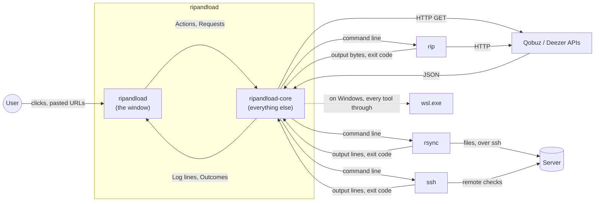
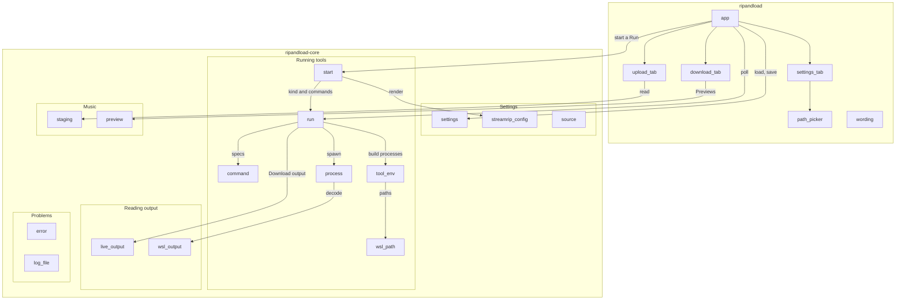
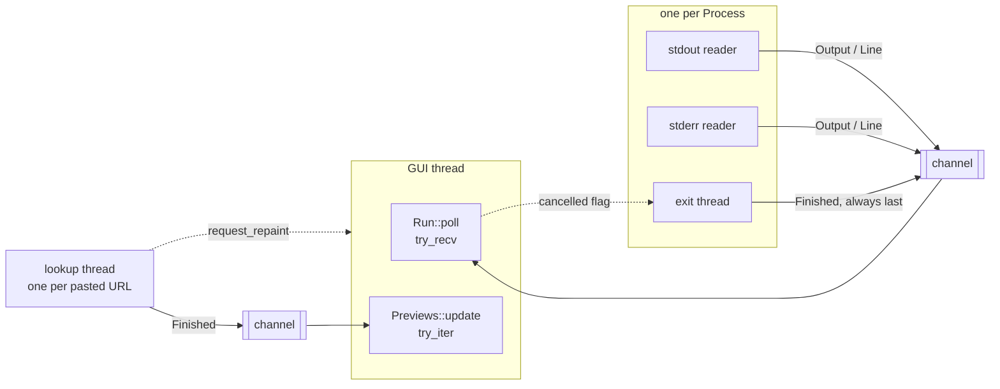

# Architecture

This is the overview. Each section says how one part of the app works in a
few paragraphs, then links to the pipeline that traces it through the code.
Read it first, then follow the links.

Source, Download, Staging folder, Upload, Server, Run and the other
capitalised terms are defined in the [glossary](../../GLOSSARY.md).

## The app in one page

ripandload downloads music from a Source, Qobuz or Deezer, into the Staging
folder, a folder on this computer. Then it Uploads the Staging folder to a
Server, a friend group's music server reached over ssh. It's a desktop app
with three tabs: Download, Upload and Settings.

The app does none of the hard work itself. streamrip's `rip` downloads,
rsync uploads, and ssh reaches the Server. The app builds their command
lines, starts them, reads what they print, and shows it. On Windows the
tools run inside WSL, through `wsl.exe`. The only network calls the app
makes itself are to the Sources' public APIs, for the Preview of a pasted
URL.



The tools are black boxes here, as in every document: what the app builds
for them, what it reads back, and which exit codes it acts on.

## The two-crate split

The code is two crates in one Cargo workspace.

- **`ripandload`**, in `crates/ripandload/`, is the program. It opens the
  window and draws the tabs. It decides nothing about tools or files.
- **`ripandload-core`**, in `crates/ripandload-core/`, is a library. It
  holds the Settings, the Streamrip config, the command lines, running the
  tools, reading their output, and the Staging folder.

The core crate knows nothing about the GUI. Nothing in it draws, and nothing
in it depends on egui. So every piece of it can be tested without opening a
window, and most of the tests live there (see [Testing](#testing)).

The GUI crate calls into the core crate. Never the other way round.

## Module map

The core crate's modules fall into five groups, as its `lib.rs` lists them.
The GUI crate has one module per tab, plus the window around them.



Only the main calls are drawn, not every `use`. `error` is used almost
everywhere.

- **Settings:** `settings` loads and saves the Settings file.
  `streamrip_config` writes the Streamrip config. `source` knows the two
  Sources and their Quality levels.
- **Running tools:** `start` turns a request into a Run. `run` drives it,
  with one file per kind of Run under `run/`. `command` builds command lines
  as plain values. `tool_env` turns them into processes, natively or inside
  WSL, with `wsl_path` converting paths. `process` starts one process and
  streams its output back.
- **Reading output:** `live_output` replays `rip`'s progress bars.
  `wsl_output` decodes what comes through `wsl.exe`.
- **Music:** `staging` reads and clears the Staging folder, and holds the
  Comparison. `preview` looks up a pasted URL's Preview.
- **Problems:** `error` holds every error type, and `error_chain`.
  `log_file` opens the Log file.

> **Rust:** a crate is split into modules, one per file. `pub mod command;`
> in `lib.rs` makes `command.rs` a module others can use.
> → [primer: crates, modules, `use` and visibility](rust-primer.md#crates-modules-use-and-visibility)

## The immediate-mode GUI loop

The window is drawn with egui, an *immediate-mode* GUI library. There are
no widget objects that live on and fire events. Instead, the whole window
is drawn again on every frame, by plain function calls, and a button
reports whether it was clicked as it's drawn.

So on every frame, `RipAndLoadApp::ui`, in `crates/ripandload/src/app.rs`,
does the same things in the same order:

```rust
let ctx = ui.ctx().clone();
self.poll_run(&ctx);
// … the tab bar, the Status bar, the Log, the Live display
egui::CentralPanel::default().show(ui, |ui| match self.tab {
    // … the open tab
});
self.confirm_clear(&ctx);
self.guard_close(&ctx);
```

1. Poll the current Run, moving its new output into the Log.
2. Draw the tab bar, the Status bar, the Log, and the Live display while a
   Download shows one.
3. Draw the open tab. The tab returns an `Action`: what the user clicked,
   if anything. The app acts on it: it starts a Run with `start::start`,
   cancels one, or saves the Settings.
4. Draw the two dialogs, if one is open.

The tabs never start anything themselves. They edit their own state, such
as the pasted text or the Settings, and report clicks. Everything that
changes the app happens in `app.rs`.

egui draws a frame only when something happens, such as a key press or a
mouse move. Code that waits for time to pass, or for another thread, must
ask for a frame: `request_repaint_after` for "in 500 ms", `request_repaint`
for "now". Both pipelines below show why.

Goes deeper in: [URL recognition: waiting for the text box to settle](pipelines/url-recognition.md#2-waiting-for-the-text-box-to-settle)
and [Settings: saving](pipelines/settings.md#5-saving).

## Concurrency

The GUI thread must never wait, or the window freezes. But reading a
process's output, waiting for it to exit, and asking an API over HTTP all
wait. So each of those gets a thread of its own, and talks to the GUI
thread over a channel.



- **Each process** a Run starts gets two reader threads, one per output
  stream, and one exit thread. They all send on one channel, and the exit
  thread always sends `Finished` last. The GUI thread holds the other end.
- **Each pasted URL** gets one lookup thread for its Preview. All lookups
  share one channel.
- **The GUI thread only ever calls `try_recv`** (or `try_iter`). It takes
  whatever has arrived and never waits for more.
- **Cancel** goes the other way, through a shared flag the exit thread
  checks every 20 ms.

A lookup thread asks for a frame when it's done, with `request_repaint`. A
process's threads don't know about the GUI, so while a Run goes, the GUI
asks for a frame every 100 ms itself.

There is no async runtime. A few threads at a time, each waiting on one
thing, are simpler to follow than tasks on an executor.

> **Rust:** a channel has a sending end, which can be cloned and handed to
> many threads, and one receiving end. `try_recv` takes the next message if
> there is one, without waiting.
> → [primer: channels](rust-primer.md#channels-and-try_recv)

Goes deeper in: [Download: where the threads are](pipelines/download.md#where-the-threads-are).

## The life of a Run

A Run is one Download, Upload, Compare with Server, Test connection or
Check tools. Every Run goes the same way.

1. **`start::start`** turns the Settings and the request into a kind of Run
   and its commands. Whatever goes wrong before the first process is a
   `CantStart`, and then no Run exists.
2. **`Run::new`** starts the first command.
3. **`Run::poll`**, once a frame, moves the output into the Log. When a
   command ends, it logs how, and starts the next.
4. **`Run::is_finished`** turns true when nothing runs and nothing is left.
5. **`Run::take_outcome`** hands the app what it has to catch up with, once:
   `Downloaded`, `Compared`, `Uploaded` or `Nothing`.

What sets one kind of Run apart is its **`Kind`**, a trait with one
implementation per file under `crates/ripandload-core/src/run/`. The kind
builds its commands, reads their output, gives hints for failures, and
gives the Outcome. It never writes the Log. It returns `Note`s, a line or a
problem, and the Run writes and counts them.

A Run stops at its first problem. Check tools is the exception: one missing
tool shouldn't hide the others.

`Run` has no state enum. Its state is read from four fields:

```rust
pub struct Run {
    // …
    queue: VecDeque<CommandSpec>,
    current: Option<(CommandSpec, Process)>,
    outcome: Option<Outcome>,
    // …
    cancelled: bool,
}
```

The states below are derived from them, not stored:

```mermaid
stateDiagram-v2
    [*] --> CantStart: start::start fails
    CantStart --> [*]: no Run exists
    [*] --> Running: Run::new
    Running --> Running: a command ends, the next starts
    Running --> Finished: queue empty, or a problem stops it
    Running --> Finished: Cancel
    state Finished {
        Succeeded
        Failed
        Cancelled
    }
    Finished --> OutcomeTaken: take_outcome
    OutcomeTaken --> [*]
```

- **Running**: `current` is `Some`.
- **Finished**: `current` is `None`. It **succeeded** with no problem
  counted and `cancelled` false, **was cancelled** if `cancelled` is true,
  and **failed** otherwise.
- **Outcome taken**: `outcome` is `None` again after `take_outcome`.

> **Rust:** `Kind` is a trait: a set of methods each kind of Run
> implements, with defaults for most. The Run holds its kind as a
> `Box<dyn Kind>`, so it can be any of them.
> → [primer: traits and default methods](rust-primer.md#traits-and-default-methods)

Goes deeper in: [Download, step by step](pipelines/download.md#example-a-step-by-step)
and [Check tools](pipelines/checks.md#part-1-check-tools), which carries on
after a problem.

## Error handling

Every problem ends up in one of three places, depending on who needs to
know.

**The Status bar**, for what the user just asked for. A Run that can't
start puts its `CantStart` there. A Run that ended says how:
`Download finished`, `Check tools: all good`, `Upload: 1 problem, see the
log`. Errors are enums, one per area, in
`crates/ripandload-core/src/error.rs`: `CantStart`, `SettingsError`,
`StagingError` and the rest. Each wraps the error that caused it.
`error_chain` joins the whole chain into one line:
`couldn't get the Streamrip config ready: the Streamrip config … isn't
valid TOML; …`.

**The Log**, for what a Run did. A Run writes each command line (`$ …`), the
tools' output, and its own lines from its kind's `Note`s:

- `✓ …`, a check that passed;
- `⚠ …`, a check that found something wrong, counted as a problem;
- `✗ …`, a command that couldn't start or failed, with a hint when the
  exit code has one clear cause;
- `→ …`, a hint, such as where Check tools found streamrip.

**The Log file**, for later. Everything a Run logs, and every error, also
goes through `tracing` into `ripandload.log`, which a friend can send when
something goes wrong. Errors go in through `error_chain`, never through
`Debug`. A TOML error's `Debug` holds the whole file it was reading,
Credentials included.

> **Rust:** each error enum derives its messages with `thiserror`. `?`
> passes an error up to the caller, converting it on the way.
> → [primer: `Result`, `?` and error enums](rust-primer.md#result-and-error-enums)

Goes deeper in: [Check tools and Test connection](pipelines/checks.md),
for hints and `✗` lines, and
[Settings: a Settings file that isn't TOML](pipelines/settings.md#example-d-a-settings-file-that-isnt-toml),
for load and save errors.

## Native and WSL

On Linux the tools run directly. On Windows they run inside a WSL distro,
since streamrip and rsync are Unix tools
([ADR 0001](../adr/0001-windows-tools-run-in-wsl.md)).

One type decides: **`ToolEnv`**, in `crates/ripandload-core/src/tool_env.rs`,
either `Native` or `Wsl`. Command lines are built as plain `CommandSpec`
values that know nothing about WSL. `ToolEnv` turns each into a process.
Inside WSL that changes four things.

- **The command line.** Every tool runs as
  `wsl.exe -d <distro> --exec … sh -c <wrapper> <tool> <arguments>`. The
  wrapper records the tool's process ID, so Cancel can stop it inside WSL.
- **Paths.** A Windows path the tools must read becomes the path WSL sees,
  `C:\Users\ana\…` as `/mnt/c/Users/ana/…`, with `wsl_path`.
- **Output.** `wsl.exe`'s own messages may come in UTF-16LE.
  `wsl_output` decodes each line as UTF-16LE or UTF-8.
- **The SSH key.** ssh inside WSL refuses a key on `/mnt/c`, so it's copied
  into `~/.ssh` inside WSL first.

The rest of the app doesn't ask where the tools run.

Goes deeper in: [Download: inside WSL](pipelines/download.md#example-b-the-same-download-inside-wsl),
for the command lines and paths, and
[Check tools: a WSL distro that doesn't exist](pipelines/checks.md#example-c-a-wsl-distro-that-doesnt-exist),
for the WSL check and decoding.

## Files on disk

| File | Module | Linux | Windows | ADR |
|---|---|---|---|---|
| Settings file | `settings` | `~/.config/ripandload/settings.toml` | `%APPDATA%\ripandload\config\settings.toml` | |
| Streamrip config | `streamrip_config` | `~/.config/ripandload/streamrip.toml` | `%APPDATA%\ripandload\config\streamrip.toml` | [0002](../adr/0002-app-owned-streamrip-config.md) |
| streamrip's databases | `streamrip_config` | `downloads.db` and `failed_downloads.db` next to the Streamrip config | the same | [0002](../adr/0002-app-owned-streamrip-config.md) |
| Personal streamrip config, only read | `streamrip_config` | `~/.config/streamrip/config.toml` | none | [0002](../adr/0002-app-owned-streamrip-config.md) |
| Log file | `log_file` | `~/.local/share/ripandload/ripandload.log` | `%APPDATA%\ripandload\data\ripandload.log` | |
| The previous run's Log file | `log_file` | `ripandload.old.log`, next to it | the same | |
| Staging folder, by default | `settings` | `~/Music/ripandload` | `%USERPROFILE%\Music\ripandload` | |
| SSH key, copied | `tool_env` | none | `~/.ssh/ripandload_key` inside WSL | [0001](../adr/0001-windows-tools-run-in-wsl.md) |
| The running tool's process ID | `tool_env` | none | `/tmp/ripandload.pid` inside WSL | [0001](../adr/0001-windows-tools-run-in-wsl.md) |

The Settings file and the Streamrip config hold Credentials, so on Unix
they're written readable by their owner only.

Goes deeper in: [Settings round-trip](pipelines/settings.md), for the
Settings file, the Streamrip config and seeding, and
[Download: the end](pipelines/download.md#8-the-end), for what lands in the
Staging folder.

## Testing

This is the one place the docs explain how the app is tested. Each pipeline
only ends with a "Tested by" line naming its tests.

**Why the core crate has no GUI.** Everything that decides anything lives in
`ripandload-core`, which never opens a window. So it's tested with plain
`cargo test`. The GUI crate holds a few unit tests, for logic that doesn't
draw, such as the Preview rounds in `download_tab.rs`.

**Two kinds of test.**

- **Unit tests** sit at the bottom of the module they test, in a
  `mod tests` block. They can reach private items, and most need no disk or
  process: a command line built, a line of output read, a TOML document
  edited.
- **Integration tests** are in `crates/ripandload-core/tests/`, one file per
  area. They use the crate from outside, as the GUI does, and run real
  processes on real files in a temporary folder.

**Stand-ins for `rip`.** The tests never run the real streamrip. `rip` is
played by small `sh` scripts in `crates/ripandload-core/tests/fixtures/`:
`fake-rip.sh` prints a set number of lines at a set pace and exits with a
set code, and `script-rip.sh` runs whatever script a test hands it. The
helpers in `crates/ripandload-core/tests/common/` set them up. Shell scripts
need a Unix shell, so those tests run on Unix only.

**Recorded fixtures.** Some inputs are real recordings:

- `rich13-progress.out` and `rich13-one-row.out`, streamrip's progress bars
  as rich 13 wrote them, for `LiveOutput`;
- `preview/`, the Qobuz and Deezer APIs' answers, for `preview::describe`;
- `personal-streamrip.toml`, a streamrip 2.2.0 config, to seed from.

**A real Server.** `crates/ripandload-core/tests/ssh_target.rs` checks
Upload, Compare with Server and Test connection against a real Server.
`dev/ssh-target.sh start` runs one in Docker: OpenSSH and rsync on
`localhost:2222`, with its music folder mounted from
`target/ssh-target/music`. Those tests need the container, and they share
its music folder, so they're `#[ignore]`d by default and run one at a time:

```text
dev/ssh-target.sh start
cargo test -p ripandload-core --test ssh_target -- --ignored --test-threads=1
```

They run the tools natively, so they're Unix-only too. Nothing in the tests
runs `wsl.exe`: the WSL paths are tested only at the unit level, by the
command lines and paths they build.

**`dev/check.sh`** runs everything a change must pass before it's committed,
warnings denied: `cargo fmt`, clippy with the doc-comment lints, rustdoc,
the tests, and a check of the comment rules no lint covers.
