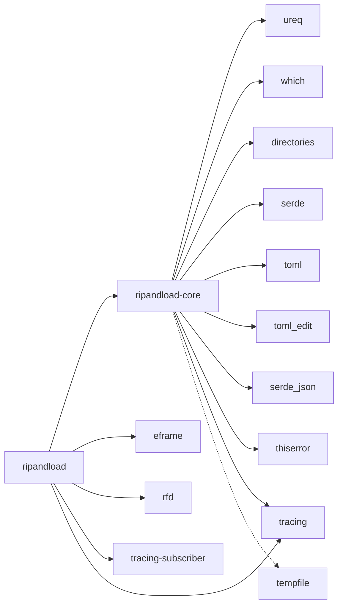

# Crates

This is every crate the app depends on directly: what it does, why the app
needs it, what else could have done the job, and where it's used. A crate is
Rust's unit of code reuse, a library or a program. The crates below come
from crates.io.

Only direct dependencies get an entry. A crate they pull in, such as egui
under eframe, is named inside its parent's entry.

Source, Settings, Streamrip config and the other capitalised terms are
defined in the [glossary](../../GLOSSARY.md).



The split follows the [two-crate split](architecture.md#the-two-crate-split).
The GUI crate owns the window (eframe), the file dialogs (rfd) and where the
logs go (tracing-subscriber). The core crate owns everything else. Both log
through `tracing`. The dashed arrow is a dev-dependency, used only by the
tests.

## Workspace mechanics

The two crates are one Cargo *workspace*, rooted at the top-level
`Cargo.toml`. Each dependency's version is written once, there:

```toml
[workspace.dependencies]
ripandload-core = { path = "crates/ripandload-core" }
eframe = { version = "0.37", features = ["glow"] }
# …
```

Each crate's own `Cargo.toml` then names the dependency without a version:

```toml
[dependencies]
eframe.workspace = true
```

So both crates are always on the same versions, and an upgrade is a
one-line change.

The root `Cargo.toml` also holds `[workspace.lints]`: the doc-comment lints
and clippy's settings, shared by both crates. They're warnings in a normal
build. `dev/check.sh` denies them.

→ [primer: Cargo workspaces and dependency features](rust-primer.md#cargo-workspaces-and-dependency-features)

## The two workspace crates

- **`ripandload`**, `crates/ripandload/`: the program, the window and its
  tabs.
- **`ripandload-core`**, `crates/ripandload-core/`: a library with
  everything else.

`ripandload` depends on `ripandload-core`, through a `path` dependency, and
never the other way round.
→ [architecture: the two-crate split](architecture.md#the-two-crate-split)

## GUI

### eframe

**What it does.** It opens the window, runs the event loop, and draws with
egui, an immediate-mode GUI library. eframe is egui's own framework: it
brings egui, winit for the window and its events, and a renderer.

**Why the app needs it.** It's the whole window. `main.rs` opens it:

```rust
eframe::run_native(
    "ripandload",
    options,
    Box::new(|_cc| Ok(Box::new(app::RipAndLoadApp::new()))),
)
```

From then on, eframe calls `RipAndLoadApp::ui` for every frame, and `app.rs`
and every tab draw with egui.
→ [architecture: the immediate-mode GUI loop](architecture.md#the-immediate-mode-gui-loop)

**The renderer.** eframe can draw with OpenGL, through glow, or with wgpu.
The app uses glow by default, because wgpu flickered and lagged when the
window was resized on Windows. `renderer_from_env` in `main.rs` switches to
wgpu when `RIPANDLOAD_RENDERER=wgpu`:

```rust
match std::env::var("RIPANDLOAD_RENDERER").as_deref() {
    Ok("wgpu") => eframe::Renderer::Wgpu,
    _ => eframe::Renderer::Glow,
}
```

**The alternative.** A retained-mode toolkit, such as GTK bindings or a web
view, would need widget objects kept in step with the app's state. With
egui the state is drawn as it is, every frame, and the tabs stay plain
functions.

Used by: `ripandload`.

### rfd

**What it does.** It opens the operating system's own file and folder
dialogs.

**Why the app needs it.** Every path in the Settings, such as the Staging
folder and the SSH key, has a Browse… button. `PathPicker::browse` in
`crates/ripandload/src/path_picker.rs` opens the dialog:

```rust
let mut dialog = rfd::FileDialog::new();
// …
let picked = match self.pick {
    Pick::Folder => dialog.pick_folder(),
    Pick::File => dialog.pick_file(),
}?;
```

**The alternative.** `egui-file-dialog` draws a file browser inside the
window, with egui. The OS dialog is the one users know, with their
bookmarks and recent folders.

Used by: `ripandload`.

## I/O and processes

### ureq

**What it does.** It sends HTTP requests, and waits for the answer.

**Why the app needs it.** The Preview of a pasted URL comes from the
Source's public API. `preview::fetch` in
`crates/ripandload-core/src/preview.rs` builds a client with a timeout:

```rust
let agent: Agent = Agent::config_builder()
    .timeout_global(Some(TIMEOUT))
    .build()
    .into();
```

**The alternative.** reqwest is the best-known Rust HTTP client, but it's
async, and brings tokio, an async runtime the app doesn't otherwise have.
Each lookup already runs on a thread of its own, so a small client that
blocks that thread is all it needs.
→ [URL recognition: asking the API](pipelines/url-recognition.md#5-asking-the-api)

Used by: `ripandload-core`.

### which

**What it does.** It finds an executable on a `PATH`, as a shell would.

**Why the app needs it.** Natively, `resolve` in
`crates/ripandload-core/src/tool_env.rs` looks each tool up before starting
it:

```rust
which::which_in(tool.name(), search_path, cwd).map_err(|source| ToolError::NotFound {
    tool: tool.name(),
    hint,
    source,
})
```

A miss becomes a `ToolError::NotFound`, which names the tool and says how
to get it: `` `rsync` wasn't found on PATH; install rsync ``.

**The alternative.** Let `Command::new` fail when the process is started.
That error says only "No such file or directory", without the tool's name
or a hint.
→ [Check tools: how a missing tool shows up](pipelines/checks.md#check-tools-and-test-connection)

Used by: `ripandload-core`.

### directories

**What it does.** It knows each operating system's folders for config, data
and music.

**Why the app needs it.** The Settings file, the Streamrip config, the Log
file and the default Staging folder each go in the usual place for the
system. `Settings::default_path` in `crates/ripandload-core/src/settings.rs`:

```rust
directories::ProjectDirs::from("", "", "ripandload")
    .map(|dirs| dirs.config_dir().join("settings.toml"))
```

On Linux that is `~/.config/ripandload/settings.toml`. On Windows it is
`%APPDATA%\ripandload\config\settings.toml`. `streamrip_config.rs` and
`log_file.rs` use it the same way.

**The alternative.** Writing the XDG and `%APPDATA%` rules by hand, with
their fallbacks.
→ [architecture: files on disk](architecture.md#files-on-disk)

Used by: `ripandload-core`.

## Data formats

### serde

**What it does.** It generates the code that turns a Rust struct into a
data format and back, from a `derive`.

**Why the app needs it.** The Settings are read from TOML and written back.
`Settings` in `crates/ripandload-core/src/settings.rs` says so in one line:

```rust
#[derive(Debug, Clone, PartialEq, Serialize, Deserialize)]
#[serde(default)]
pub struct Settings {
```

serde itself knows no format. `toml` uses it.

**The alternative.** Reading each key by hand from a parsed TOML table, and
writing it back the same way.
→ [Settings: loading](pipelines/settings.md#1-loading)

Used by: `ripandload-core`, with its `derive` feature.

### toml

**What it does.** It reads and writes TOML, through serde.

**Why the app needs it.** The Settings file is TOML, and the app owns all of
it. `Settings::load` reads it whole with `toml::from_str`, and
`Settings::save` writes it whole:

```rust
let text = toml::to_string_pretty(self)?;
```

**The alternative.** JSON, which can't hold comments and is harder to edit
by hand. Both streamrip and Rust's own tools use TOML for config files.

Used by: `ripandload-core`.

### toml_edit

**What it does.** It edits a TOML document in place, keeping its comments,
blank lines and key order.

**Why the app needs it.** The Streamrip config is also TOML, but the app
owns only some of its keys
([ADR 0002](../adr/0002-app-owned-streamrip-config.md)). The rest are the
user's or streamrip's, with streamrip's comments. `streamrip_config::render`
in `crates/ripandload-core/src/streamrip_config.rs` parses the file into a
document, changes the managed keys, and writes it back:

```rust
let mut doc: DocumentMut = text.parse().map_err(|source| StreamripConfigError::Parse {
    // …
apply(
    // …
)?;
write_private(config, doc.to_string().as_bytes())?;
```

**Why both `toml` and `toml_edit`.** `toml` reads a file into plain values
and writes them out fresh, dropping the comments. That's right for the
Settings file, which the app owns whole. `toml_edit` keeps the document as
it was written and changes only what it's told. That's right for the
Streamrip config, which the app only partly owns.
→ [Settings: rendering](pipelines/settings.md#6-rendering)

Used by: `ripandload-core`.

### serde_json

**What it does.** It reads and writes JSON.

**Why the app needs it.** The Qobuz and Deezer APIs answer in JSON.
`preview::describe` in `crates/ripandload-core/src/preview.rs` reads the
answer as an untyped `Value`, and picks the names out by path:

```rust
let json: Value = serde_json::from_str(body).ok()?;
let text = |pointer: &str| {
    json.pointer(pointer)
```

**The alternative.** A typed struct per answer, with serde. The app needs
two or three fields from answers of eight shapes (two Sources, four kinds),
so a lookup by path is shorter, and a missing field is just `None`.

Used by: `ripandload-core`.

## Errors and logging

### thiserror

**What it does.** It generates an error type's message and its link to the
error that caused it, from a `derive`.

**Why the app needs it.** Every error in the core crate is an enum, in
`crates/ripandload-core/src/error.rs`, such as:

```rust
#[derive(Debug, thiserror::Error)]
pub enum ProcessError {
    /// The OS refused to start the process.
    #[error("couldn't start {program}")]
    Spawn {
```

`#[error(...)]` is the message. A field marked `#[source]` is the cause,
which `error_chain` follows to build the one-line message the Status bar
shows.

**The alternative.** anyhow, which wraps any error in one opaque type. The
core crate's callers match on its errors, such as `CantStart`, so they must
stay typed. And the GUI only shows them, through `error_chain`, so it
doesn't need anyhow either.
→ [architecture: error handling](architecture.md#error-handling)

Used by: `ripandload-core`.

### tracing

**What it does.** It records log events, with a level and fields, for a
subscriber to write somewhere.

**Why the app needs it.** Everything a Run logs, and every error, also goes
to the Log file. `Run::start_next` in `crates/ripandload-core/src/run.rs`
logs each command line:

```rust
tracing::info!("$ {spec}");
```

`run.rs`, `start.rs`, `streamrip_config.rs`, `app.rs`, `download_tab.rs`
and `main.rs` log this way. No spans are used, only events.

**The alternative.** `log`, with `env_logger`. tracing is now the usual
choice, and filters by module the same way.

Used by: `ripandload` and `ripandload-core`.

### tracing-subscriber

**What it does.** It decides where `tracing` events go, and which to keep.

**Why the app needs it.** `init_logging` in `crates/ripandload/src/main.rs`
sends every event to stderr and to the Log file, filtered by `RUST_LOG`:

```rust
tracing_subscriber::registry()
    .with(filter)
    .with(tracing_subscriber::fmt::layer())
    .with(file_layer)
    .init();
```

The `env-filter` feature reads `RUST_LOG`, `ripandload=info` when it's
unset. A release build on Windows has no console, so the Log file is the
only place its logs go.

**The alternative.** Writing to the file by hand would miss the events from
the core crate, which only knows `tracing`. Setting the subscriber up is the
program's job, so it lives in the GUI crate and nowhere else.

Used by: `ripandload`, with its `env-filter` feature.

## Tests

### tempfile

**What it does.** It creates a temporary folder that's deleted when the
test ends.

**Why the app needs it.** Many tests write real files: a Staging folder to
read or clear, a Settings file to save and load, a Streamrip config to
render. Each gets a folder of its own:

```rust
let dir = tempfile::tempdir().unwrap();
```

It's used by the unit tests in `run/compare.rs`, `run/upload.rs`,
`settings.rs`, `staging.rs`, `start.rs` and `tool_env.rs`, and by the
integration tests `log_file.rs`, `run.rs`, `ssh_target.rs` and
`streamrip_config.rs` in `crates/ripandload-core/tests/`.

**The alternative.** Fixed folders under `target/`, which tests running in
parallel would share, and which a failed test would leave behind.
→ [architecture: testing](architecture.md#testing)

Used by: `ripandload-core`, as a dev-dependency, so only its tests build it.
