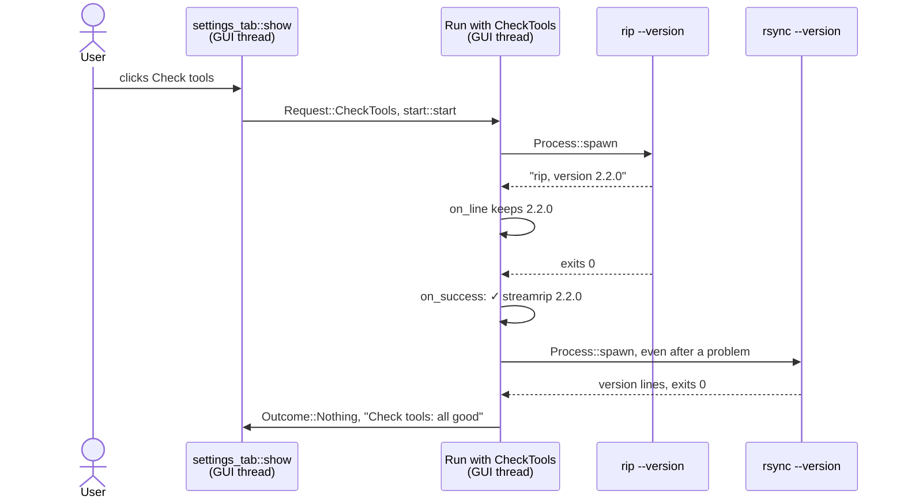
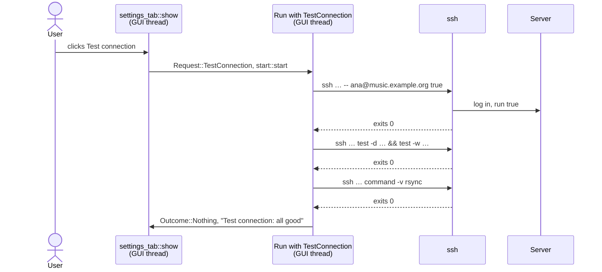

# Check tools and Test connection

Two buttons on the Settings tab ask whether the app can work, before a real
Download or Upload finds out the hard way.

- **Check tools** runs `rip --version` and `rsync --version`. It says
  whether each tool is there, and whether streamrip is the version the app
  is made for.
- **Test connection** runs three ssh commands on the Server: log in, check
  the music folder, check that rsync is there.

Both are Runs, like a Download. Processes, threads and polling work as in
the [Download](download.md), and are only linked to here. The ssh options
and the SSH key's copy into WSL are explained in
[Compare with Server](compare.md).

Server, Settings, Run and the other capitalised terms are defined in the
[glossary](../../../GLOSSARY.md).

**How a missing tool shows up** depends on where the tools run.

- **Natively**, `ToolEnv::command` looks the tool up on `PATH` before
  starting anything, with `which::which_in`, in `resolve` in
  `crates/ripandload-core/src/tool_env.rs`. A miss is a
  `ToolError::NotFound`, and the Log gets
  `` ✗ `rsync` wasn't found on PATH; install rsync: cannot find binary path ``.
  A `rip` path set in the Settings skips the lookup. If nothing is there, it
  fails when it's started instead:
  `✗ couldn't start /opt/streamrip/bin/rip: No such file or directory`.
- **Inside WSL**, nothing is looked up beforehand. `wsl.exe` starts, and the
  wrapper's `exec` inside WSL fails, exiting with 127, the shell's code for
  "command not found". The app reads that exit code.

## Part 1: Check tools



### The examples

- **A**, on Linux, with everything found. It goes through every step.
- **B**, inside WSL, with `rip` not where the Settings say. A pyenv probe
  looks for it, and rsync is still checked.
- **C**, inside WSL, with a WSL distro that doesn't exist. Nothing else
  runs.

Two cases take one line each:

- **An old streamrip.** `rip --version` prints `rip, version 2.1.0`, and
  the Log gets `⚠ streamrip 2.1.0 found, but ripandload is made for 2.2.0`.
  That counts as a problem.
- **rsync missing, natively.** The Log gets
  `` ✗ `rsync` wasn't found on PATH; install rsync: cannot find binary path ``,
  from `ToolError::NotFound`. → [crates: which](../crates.md)

A is followed step by step below. B and C come after it, and only tell
where they differ.

### Example A, step by step

#### 1. The click

The function is **`settings_tab::show`**, in
`crates/ripandload/src/settings_tab.rs`. Check tools needs no Server, so
it's enabled whenever no Run is going:

```rust
if ui
    .add_enabled(!run_going, egui::Button::new("Check tools"))
    .on_hover_text("Runs rip --version and rsync --version")
    .clicked()
{
    action = Action::CheckTools;
}
```

The tab returns `Action::CheckTools`, and the app calls `start_run` with
`Request::CheckTools`, as for a [Download](download.md#1-the-click).

#### 2. Starting the Run

The function is **`CheckTools::new`**, in
`crates/ripandload-core/src/run/check_tools.rs`. `kind_and_commands` calls
it with the `ToolEnv`:

```rust
let wsl_check = tool_env.is_wsl().then(command::wsl_check_spec);
let specs = wsl_check.into_iter().chain(command::version_specs());
return (Self::default(), specs.collect());
```

Inside WSL, a WSL check comes first (example C). On Linux there is none, so
the commands are only the two from `command::version_specs`.

Check tools has no paths to convert and nothing to read, so it can't fail
to start: there is no `CantStart` for it.

#### 3. The command lines

The two commands, as the Log shows them:

```text
$ rip --version
$ rsync --version
```

`rip` is the path from the Settings, if one is set. Otherwise it's looked up
on `PATH`, like `rsync`. → [Download: spawning](download.md#5-spawning)

ssh isn't checked here. Only the Server Runs use it, and a missing ssh shows
up in Test connection.

#### 4. Spawning, and carrying on

The commands run one after another, each with its own process, as in the
Download. → [Download: the process's threads](download.md#6-the-processs-threads)

One thing is different. Every other Run stops at its first problem.
Check tools doesn't:

```rust
fn stops_at_first_problem(&self) -> bool {
    return false;
}
```

**Why carry on.** One missing tool shouldn't hide the others. If `rip`
isn't there, the user still wants to know about rsync, and fix both at
once.

#### 5. Reading rip's line

The function is **`CheckTools::on_line`**. `Run::poll` calls it for every
line a command prints. For `rip --version`, the one line is
`rip, version 2.2.0`:

```rust
if spec.program == Tool::Rip
    && let Some(version) = command::parse_rip_version(&line)
{
    self.rip_version = Some(version.to_owned());
}
return vec![Note::Line(line)];
```

**`command::parse_rip_version`**, in `crates/ripandload-core/src/command.rs`,
finds the version after `, version `, here `Some("2.2.0")`. The kind keeps
it in `rip_version` until `rip` ends. The line itself still goes to the Log.

> **Rust:** `if … && let Some(version) = …` is a let chain: the block runs
> only if the command is `rip` *and* the line holds a version, which is then
> named `version` inside it.
> → [primer: `if let`, `let … else` and let chains](../rust-primer.md#if-let-let--else-and-let-chains)

#### 6. rip ends

`rip` exits with 0, and the Run calls **`CheckTools::on_success`**:

```rust
let note = match self.rip_version.take() {
    Some(version) if version == STREAMRIP_VERSION => {
        Note::Line(format!("✓ streamrip {version}"))
    }
    Some(version) => Note::Problem(format!(
        "⚠ streamrip {version} found, but ripandload is made for {STREAMRIP_VERSION}"
    )),
    None => Note::Problem("⚠ couldn't tell which streamrip version this is".into()),
};
```

The version is compared with `STREAMRIP_VERSION`, `"2.2.0"`. For A they're
the same, so the Log gets `✓ streamrip 2.2.0`. Another version, or none,
is a `Note::Problem`: the Log gets a `⚠` line, and the Run counts it.

**Why one exact version.** The app writes the Streamrip config's keys in
streamrip 2.2.0's format. Another version may name them differently, or
read them differently. → [Settings: the managed keys](settings.md#7-the-managed-keys)

#### 7. rsync

`rsync --version` prints several lines, starting something like
`rsync  version 3.2.7  protocol version 31`. They go to the Log as they
are. `on_success` returns nothing for rsync: any version will do.

#### 8. The end

The queue is empty. Check tools leaves nothing for the app to catch up with,
so its Outcome is the default, `Outcome::Nothing`.

The Log for A:

```text
$ rip --version
rip, version 2.2.0
✓ streamrip 2.2.0
$ rsync --version
rsync  version 3.2.7  protocol version 31
…
```

The Status bar reads `Check tools: all good`. With problems, it would read
`Check tools: 1 problem, see the log`, or `2 problems`.

### Example B: inside WSL, rip isn't where the Settings say

The Settings name no path for `rip`, so inside WSL the app runs the venv the
WSL setup steps create, `~/.local/share/ripandload/venv/bin/rip`. But the
user installed streamrip with pyenv instead.

In step 2, the commands are the WSL check, then the two version checks. The
WSL check, `sh -c true`, passes.

In step 4, `rip --version` exits with 127: there is no file at that path.
The Run asks **`CheckTools::on_failure`** what to do:

```rust
if let Some(hint) = rip_missing_hint(spec, code, wsl) {
    return Failure {
        hint: Some(hint),
        next: Next::RunFirst(command::pyenv_probe_spec()),
    };
}
```

`rip_missing_hint` gives a hint when `rip`, inside WSL, exited with 127. The
Log gets:

```text
✗ rip --version failed with exit code 127: streamrip isn't where Settings say inside WSL; follow the WSL setup steps, or set its path in Settings (with pyenv, e.g. ~/.pyenv/versions/<name>/bin/rip)
```

`Next::RunFirst` puts the pyenv probe at the front of the queue, before
rsync. The probe is a small `sh` script:

```text
ls -d ~/.pyenv/versions/*/bin/rip ~/.pyenv/shims/rip 2>/dev/null
```

It prints every streamrip it finds under pyenv. `on_line` turns each line
it prints into a hint:

```text
→ found streamrip at /home/ana/.pyenv/versions/3.12.4/bin/rip; to use it, put that path in Settings
```

The probe ends quietly: `CheckTools::ends_quietly` says so, so however it
exits, nothing is logged and nothing is counted. Finding nothing isn't a
problem of its own.

Then rsync is checked, as in A. The Status bar reads
`Check tools: 1 problem, see the log`.

A Download that runs a missing `rip` inside WSL gets the same hint, without
the probe. That's why `rip_missing_hint` lives in `check_tools.rs`, for
both.

### Example C: a WSL distro that doesn't exist

The Settings name a WSL distro, `Debain`, that doesn't exist.

In step 4, the WSL check runs first: `wsl.exe -d Debain --exec sh -c … true`.
`wsl.exe` can't start the distro. It prints its own message, and exits with
a failure code.

That message may come in UTF-16LE: older `wsl.exe` versions ignore the
`WSL_UTF8=1` the app sets, and write their own messages that way. The
reader thread decodes each line with **`decode_wsl_output`**, in
`crates/ripandload-core/src/wsl_output.rs`
([ADR 0001](../../adr/0001-windows-tools-run-in-wsl.md)):

```rust
if bytes.contains(&0) {
    // UTF-16LE. A lone byte left at the end becomes `�`.
    // …
    String::from_utf16_lossy(&char_list)
} else {
    String::from_utf8_lossy(bytes).into_owned()
}
```

Text never holds a NUL byte, and UTF-16LE puts one after every ASCII
letter. So a line with a NUL is decoded as UTF-16LE, and any other as UTF-8.
The Log gets `There is no distribution with the supplied name.`, readable.

`on_failure` sees the WSL check failed:

```rust
if *spec == command::wsl_check_spec() {
    return Failure {
        hint: Some(
            "couldn't run anything inside WSL; check that WSL is installed \
             and the WSL distro in Settings exists (see wsl.exe's message above)"
                .into(),
        ),
        next: Next::StopAll,
    };
}
```

`Next::StopAll` drops the rest of the queue. Even Check tools stops here:
if nothing runs inside WSL, every check after would fail the same way.

With WSL not installed at all, `wsl.exe` itself can't be started. Each
command then fails to spawn, and the Log gets
`` ✗ couldn't start wsl.exe: …; is WSL installed? (`wsl --install` in PowerShell) ``
for each, since a spawn failure isn't an exit code for `on_failure` to read.

## Part 2: Test connection



### The examples

- **A**, on Linux, against a Server that's set up right. It goes through
  every step.
- **B**, an SSH key the Server rejects. The first check fails, and the
  others never run.
- **C**, a music folder that doesn't exist. The login passes, the folder
  check fails.

Inside WSL, the SSH key is copied into WSL first, as for a Compare.
→ [Compare: example B](compare.md#example-b-the-same-compare-inside-wsl)
And if ssh isn't installed inside WSL, the first check exits with 127, and
the Log says `ssh isn't installed inside WSL; follow the WSL setup steps`.

A is followed step by step below. B and C come after it, and only tell
where they differ.

### Example A, step by step

The Server is Compare's: `music.example.org`, user `ana`, port 22, music
folder `/srv/music`, SSH key `/home/ana/.ssh/ripandload`.

#### 1. The click

Test connection is enabled like Compare with Server: no Run going, and an
active Server that `start::server` accepts. Otherwise its hover text says
what's missing.
→ [Compare: the click](compare.md#1-the-click)

The tab returns `Action::TestConnection`, and the app calls `start_run`
with `Request::TestConnection`.

#### 2. Starting the Run

The function is **`TestConnection::new`**, in
`crates/ripandload-core/src/run/test_connection.rs`:

```rust
let (ready, copy_key) = tool_env.ssh_ready(server)?;
let kind = Self {
    rsync_check: command::rsync_check_spec(&ready),
};
let checks = command::test_connection_specs(&ready);
return Ok((kind, copy_key.into_iter().chain(checks).collect()));
```

`ssh_ready` gets the SSH key ready, as for a Compare. Natively it changes
nothing. The kind keeps the rsync check's `CommandSpec`, so it can tell
later which command failed (example C).

#### 3. The command lines

The function is **`command::test_connection_specs`**, in `command.rs`. It
builds three ssh commands, each running one shell command line on the
Server:

```rust
vec![
    remote_spec(server, "true".to_owned()),
    remote_spec(server, format!("test -d {folder} && test -w {folder}")),
    rsync_check_spec(server),
]
```

For A, the Log shows them as they start:

```text
$ ssh -i /home/ana/.ssh/ripandload -p 22 -o StrictHostKeyChecking=accept-new -o BatchMode=yes -- ana@music.example.org true
$ ssh -i /home/ana/.ssh/ripandload -p 22 -o StrictHostKeyChecking=accept-new -o BatchMode=yes -- ana@music.example.org test -d '/srv/music' && test -w '/srv/music'
$ ssh -i /home/ana/.ssh/ripandload -p 22 -o StrictHostKeyChecking=accept-new -o BatchMode=yes -- ana@music.example.org command -v rsync
```

1. `true` does nothing. It succeeds only if ssh could connect and log in.
2. `test -d F && test -w F` succeeds if the music folder is a folder and
   the user can write to it, as an Upload must.
3. `command -v rsync` succeeds if rsync is on the Server's `PATH`. An
   Upload and a Compare start rsync there too.

The options before `--` are the same `ssh_options` rsync's `-e` uses.
→ [Compare: the command line](compare.md#3-the-command-line)

**Why the remote command is one argument.** ssh joins everything after the
destination into one line for the Server's shell. The app passes that line
as a single argument, with the folder quoted for the shell by
`shell_quote`. So a folder named `/srv/my music` arrives as
`'/srv/my music'`, one word, not two.

**Why `~/` is left unquoted.** A music folder of `~/music` means the
user's home on the Server. Quoted, the shell would look for a folder
literally named `~`. So the `~/` is left outside the quotes, and the
Server's shell expands it, as rsync's would:
`test -d ~/'music' && test -w ~/'music'`.

#### 4. Spawning and polling

The commands run one after another, each with its own process, as in the
Download. → [Download: the process's threads](download.md#6-the-processs-threads)

Test connection stops at its first problem, like every Run but Check tools.
If logging in fails, checking the folder can't tell anything new.

#### 5. The end

All three commands succeed, and print nothing. `TestConnection` has no
`on_success`, so nothing is added to the Log. Its Outcome is
`Outcome::Nothing`.

The Status bar reads `Test connection: all good`.

### Example B: an SSH key the Server rejects

Steps 1 to 4 go as for A. The first ssh tries the key, and the Server
refuses it. ssh prints `ana@music.example.org: Permission denied (publickey).`
and exits with 255, its own code for "couldn't connect or log in".

The Run asks **`TestConnection::on_failure`**:

```rust
let hint = match code {
    SSH_FAILED => server::ssh_hint(code),
    // The Run says which tool.
    SHELL_NOT_FOUND if wsl => None,
    _ if *spec == self.rsync_check => {
        Some("rsync isn't installed on the Server".to_owned())
    }
    _ => Some("the music folder doesn't exist or isn't writable".to_owned()),
};
```

255 gets the hint Upload and Compare give for the same code. The Log gets:

```text
✗ ssh -i /home/ana/.ssh/ripandload … -- ana@music.example.org true failed with exit code 255: couldn't reach or log in to the Server; check its host, port, user and SSH key
```

The Run stops at this first problem, so the folder and rsync checks never
run. The Status bar reads `Test connection: 1 problem, see the log`.

A wrong port ends the same way: ssh can't connect, exits with 255, and gets
the same hint.

### Example C: the music folder is missing

Say the music folder in the Settings is `/srv/musc`, a typo.

The first check, the login, passes. The second runs
`test -d '/srv/musc' && test -w '/srv/musc'` on the Server. `test -d` fails,
and ssh passes its exit code on: 1.

In `on_failure`, 1 isn't ssh's code, and the command isn't the rsync check.
So it's the folder check's:

```text
✗ ssh … -- ana@music.example.org test -d '/srv/musc' && test -w '/srv/musc' failed with exit code 1: the music folder doesn't exist or isn't writable
```

**Why the hint follows the command.** Past the login, each check is a single
`test` or `command -v`, so a failure has one cause. The kind knows which
command failed, so it names that cause. If the rsync check had failed
instead, the hint would be `rsync isn't installed on the Server`.

## Where the threads are

Both Runs use the threads of a Download, one command at a time. Each
command, the WSL check and the pyenv probe included, gets its own process,
reader threads and exit thread, and they end before the next command
starts.
→ [Download: where the threads are](download.md#where-the-threads-are)

The WSL examples are tested only at the unit level: the tests don't run on
Windows, so nothing runs `wsl.exe`. The Test connection tests against a
real Server need the Docker container that `dev/ssh-target.sh` starts, and
are `#[ignore]`d by default.

Tested by: `crates/ripandload-core/src/run/check_tools.rs`
(`inside_wsl_the_wsl_check_runs_first`, `expected_version_is_confirmed`,
`another_version_is_a_problem`, `no_version_is_a_problem`,
`rsync_succeeding_says_nothing`, `failed_wsl_check_stops_all`,
`rip_missing_in_wsl_runs_the_pyenv_probe`, `pyenv_probe_lines_become_hints`,
`pyenv_probe_ends_quietly`), `crates/ripandload-core/src/run/test_connection.rs`
(`ssh_failed_has_the_server_hint`, `other_codes_blame_the_music_folder`,
`rsync_check_failing_blames_the_servers_rsync`,
`exit_127_inside_wsl_has_no_hint`), `crates/ripandload-core/src/run.rs`
(`exit_127_inside_wsl_says_the_tool_is_missing`,
`spawn_failure_inside_wsl_asks_about_wsl`),
`crates/ripandload-core/src/command.rs` (`version_specs_check_rip_then_rsync`,
`rip_version_is_parsed`, `other_lines_have_no_rip_version`,
`test_connection_logs_in_then_checks_the_music_folder_then_rsync`,
`test_connection_passes_the_remote_check_as_one_argument`,
`test_connection_lets_the_server_expand_a_home_folder`),
`crates/ripandload-core/src/wsl_output.rs` (`utf16le_is_decoded`,
`later_utf16le_lines_drop_the_nul_left_by_the_split`),
`crates/ripandload-core/tests/run.rs`
(`check_tools_confirms_the_expected_streamrip_version`,
`check_tools_hands_over_nothing_once`,
`check_tools_warns_about_another_streamrip_version`,
`missing_rip_is_a_problem_and_rsync_is_still_checked`) and
`crates/ripandload-core/tests/ssh_target.rs` (`test_connection_succeeds`,
`test_connection_with_a_wrong_port_says_it_cant_log_in`,
`test_connection_with_a_wrong_key_says_it_cant_log_in`,
`test_connection_with_a_missing_folder_says_so`).
