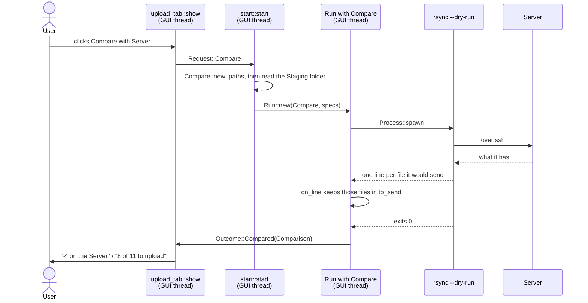

# Compare with Server

Compare with Server asks the Server which music files in the Staging folder
it already has. It sends nothing. The Upload tab then shows, for each Album
folder, whether it is on the Server or how many of its files an Upload would
still send.

The question is put to rsync. Compare runs the same rsync command as an
Upload, as a dry run that lists each file it would send. The files it
lists aren't on the Server. The others are.

This is the pipeline that explains the rsync command line in full. The
[Upload](upload.md) links back here for it. Processes, threads and polling
work as in the [Download](download.md), and are only linked to here.

Server, Staging folder, Album folder, Comparison and the other capitalised
terms are defined in the [glossary](../../../GLOSSARY.md).



## The examples

- **A**, on Linux. The Staging folder holds two Album folders. One is
  already on the Server. The other has 3 of its 11 tracks there. It goes
  through every step, and ends with one row reading `✓ on the Server` and
  one reading `8 of 11 to upload`.
- **B**, the same Compare on Windows, inside WSL. The SSH key is copied
  into WSL first, and the file names keep their accents.
- **C**, a Server that can't be reached. The Compare fails, and the Upload
  tab keeps what it showed before.

A is followed step by step below. B and C come after it, and only tell
where they differ.

## Example A, step by step

The Settings for A:

- The Staging folder is `/home/ana/Music/ripandload`. It holds
  `Zedd - True Colors (2015)`, 11 tracks, all on the Server, and
  `Björk - Debut (1993)`, 11 tracks, of which the first 3 are on the
  Server.
- The active Server is `music.example.org`, user `ana`, port 22, music
  folder `/srv/music`, SSH key `/home/ana/.ssh/ripandload`.

### 1. The click

The function is **`upload_tab::show`**, in
`crates/ripandload/src/upload_tab.rs`. The app calls it on every frame while
the Upload tab is open. It passes the active Server as
`start::server(&self.settings)`: the Server, or why it can't be used.

`start::server`, in `crates/ripandload-core/src/start.rs`, checks that there
is an active Server with a host and a music folder. If not, it gives back a
`CantStart`: `NoServer`, or `ServerIncomplete` naming what's empty.

The Compare with Server button is enabled only with no Run going and a
Server that passed:

```rust
let compare = ui
    .add_enabled(
        !run_going && server.is_ok(),
        egui::Button::new("Compare with Server"),
    )
    .on_hover_text("Asks the Server which files it already has. Sends nothing.");
if needs_server(compare).clicked() {
    action = Action::Compare;
}
```

While the button is disabled, `needs_server` gives it the error as hover
text, such as `Set the Server's host first`.

The tab returns `Action::Compare`. The app turns it into `Request::Compare`
and calls `start_run`, as for a
[Download](download.md#1-the-click). The request holds nothing else:
everything a Compare needs is in the Settings.

### 2. Starting the Run

The function is **`Compare::new`**, in
`crates/ripandload-core/src/run/compare.rs`. `start::start` calls
`kind_and_commands`, which checks the Server again with `start::server`,
then calls `Compare::new` with the `ToolEnv`, the Server, the Staging
folder, and `read_staging`, the function that reads it.

```rust
let (ready, copy_key) = tool_env.ssh_ready(server)?;
let tool_staging = tool_env.tool_path(&staging)?;
let contents = read(&staging)?;
let at_start = StagingAtStart {
    folder: staging,
    contents,
};
let compare = command::compare_spec(Path::new(&tool_staging), &ready);
let specs = copy_key.into_iter().chain([compare]).collect();
```

It does four things, in this order.

1. `ssh_ready` gets the SSH key ready for the tools. Natively there is
   nothing to do: `ready` is the Server as it is, and `copy_key` is
   `None`. Example B is where it matters.
2. `tool_path` gives the Staging folder as rsync sees it. Natively,
   unchanged: `"/home/ana/Music/ripandload"`.
3. `read` reads what is in the Staging folder now, with
   `StagingContents::read`. That is the snapshot the Comparison is built
   from, at the end.
4. `compare_spec` builds the rsync command (step 3), and the commands go
   in order: the key copy, if any, then rsync. For A that is one command.

**Why the Staging folder is read last.** Every `CantStart` that a path can
cause, an SSH key or a Staging folder rsync can't reach, comes first, before
anything is read from disk. And the snapshot is taken as close as possible
to the moment rsync starts looking.

The snapshot is a `StagingAtStart`: the Staging folder, and what was in it.
What was in it is a `StagingContents`, the music files grouped by Album
folder. For A:

```text
StagingAtStart {
    folder: "/home/ana/Music/ripandload",
    contents: StagingContents {
        groups: [
            MusicGroup { folder: Some("Björk - Debut (1993)"),
                         files: ["Björk - Debut (1993)/01. Human Behaviour.flac", …] },
            MusicGroup { folder: Some("Zedd - True Colors (2015)"),
                         files: ["Zedd - True Colors (2015)/01. Addicted To A Memory.flac", …] },
        ],
        files: 24,
    },
}
```

`files` counts every file, covers included: 22 tracks and 2 covers.

If the Staging folder can't be read, `read_staging` gives
`CantStart::Staging`, and the Compare doesn't start.

> **Rust:** `copy_key.into_iter().chain([compare]).collect()` makes a list
> of the key copy, if there is one, followed by the Compare. An `Option`
> iterates over zero or one value.
> → [primer: iterators](../rust-primer.md#iterators)

### 3. The command line

The function is **`command::compare_spec`**, in
`crates/ripandload-core/src/command.rs`. It is the Upload's rsync command,
with two options in front:

```rust
// Options go first, so the Upload's own arguments stay as they are.
let mut args: Vec<String> = ["--dry-run", "--itemize-changes"].map(String::from).into();
args.extend(rsync_args(server, staging));
```

`--dry-run` makes rsync work out what it would send, and send nothing.
`--itemize-changes` makes it print one line per item it would change, with
a code saying what would change (step 5).

The rest is **`command::rsync_args`**, the Upload's own arguments:

```rust
let path = check_trailing_slash(&staging.display().to_string());
let remote_folder = check_trailing_slash(&server.music_folder);

vec![
    "-rtv".to_string(),
    "--partial".to_string(),
    "--chmod=D755,F644".to_string(),
    "--8-bit-output".to_string(),
    "-e".to_string(),
    remote_shell(server),
    path,
    format!("{}:{remote_folder}", server.destination()),
]
```

For A the arguments are:

```text
["--dry-run", "--itemize-changes",
 "-rtv", "--partial", "--chmod=D755,F644", "--8-bit-output",
 "-e", "ssh -i /home/ana/.ssh/ripandload -p 22 -o StrictHostKeyChecking=accept-new -o BatchMode=yes",
 "/home/ana/Music/ripandload/", "ana@music.example.org:/srv/music/"]
```

Each is one argument to rsync. No shell reads them, so the spaces after
`-e` don't split it. The Log shows the command in its `Display` form,
joined with spaces and without quotes:
`$ rsync --dry-run --itemize-changes -rtv … ana@music.example.org:/srv/music/`.

What each part does:

- **`-rtv`**: copy folders recursively (`-r`), keep the files'
  modification times (`-t`), and name each file (`-v`). The times are how
  rsync tells, next time, that a file is already there: same size, same
  time.
- **`--partial`**: keep a file that was cut off halfway, so the next Upload
  goes on from there. For a dry run it changes nothing.
- **`--chmod=D755,F644`**: folders arrive readable by everyone, writable by
  the user; files the same, not executable. The music server on the other
  side can then read them, whatever the permissions were here.
- **`--8-bit-output`**: print file names as they are, accents included.
  Example B shows why it matters.
- **`-e`**: the ssh command rsync uses to reach the Server (below).
- **The Staging folder, with a trailing slash.** `/home/ana/Music/ripandload/`
  means "what's inside this folder". Without the slash, rsync would copy
  the folder itself, and the Server would get `/srv/music/ripandload/…`.
- **The destination**, `user@host:folder/`. The trailing slash makes rsync
  treat the music folder as a folder. `check_trailing_slash` adds a slash
  only when there is none, so `/srv/music/` doesn't become `/srv/music//`.

There is no `--delete`. An Upload never removes anything on the Server, so
a Compare never lists anything to remove either.

**The ssh command.** `remote_shell` builds the value after `-e` from
`ssh_options`:

```rust
if let Some(key) = &server.ssh_key {
    options.extend(["-i".to_owned(), key.display().to_string()]);
}
options.extend(
    [
        "-p",
        &server.port.to_string(),
        "-o",
        "StrictHostKeyChecking=accept-new",
        "-o",
        "BatchMode=yes",
    ]
    .map(str::to_owned),
);
```

- `-i` names the SSH key. With no key in the Settings, it's left out, and
  ssh tries its default keys and ssh-agent.
- `-p` is the port.
- `BatchMode=yes` makes ssh fail instead of asking for anything, such as a
  password. Nobody could answer: the process has no stdin.
- `StrictHostKeyChecking=accept-new` accepts a Server's host key the first
  time, without asking, and remembers it. A host key that *changed* still
  fails, since that can mean someone is in between.

rsync splits the `-e` value on spaces itself. It honours quotes, and a
doubled quote stands for a literal one. So `remote_shell` puts single
quotes around an option holding a space or a quote, and doubles the single
quotes inside it. A key at `/home/ana/My Keys/id` goes in as
`'/home/ana/My Keys/id'`.

Test connection runs the same `ssh_options`, without rsync. →
[Check tools and Test connection](checks.md)

### 4. Spawning and polling

This goes as in the Download's steps
[5](download.md#5-spawning), [6](download.md#6-the-processs-threads) and
[7](download.md#7-each-frame). `Run::new` writes `$ rsync …` to the Log,
`ToolEnv::command` finds `rsync` on `PATH`, and the Run follows the process
from the GUI thread, one frame at a time.

One thing differs. rsync draws no progress bars, so `Compare` keeps the
default `Kind::reads_raw`, which is `false`. The process is started with
`Process::spawn`, and its reader threads send whole lines,
`ProcessEvent::Line`, rather than raw bytes.

The Status bar reads `Compare with Server: running rsync --dry-run …`.

### 5. Reading lines

The function is **`Compare::on_line`**, in `run/compare.rs`. `Run::poll`
calls it for every line rsync prints.

For A, rsync prints something like:

```text
sending incremental file list
<f+++++++++ Björk - Debut (1993)/04. There's More to Life Than This.flac
<f+++++++++ Björk - Debut (1993)/05. Like Someone in Love.flac
…
<f+++++++++ Björk - Debut (1993)/11. The Anchor Song.flac

sent 1,214 bytes  received 64 bytes  852.00 bytes/sec
total size is 412,367,113  speedup is 322,665.97 (DRY RUN)
```

Each `<f` line is a file it would send. The others are rsync talking about
itself.

```rust
fn on_line(&mut self, _spec: &CommandSpec, line: String) -> Vec<Note> {
    if let Some(file) = command::itemized_file(&line) {
        self.to_send.push(PathBuf::from(file));
        return Vec::new();
    }
    return vec![Note::Line(line)];
}
```

**`command::itemized_file`**, in `command.rs`, reads the line. An itemized
line is an 11-letter code, a space, and the name, relative to the Staging
folder. The code's first letter says where it goes: `<` is sent to the
remote side, here the Server (`>` would be a local copy). The second says
what: `f` is a file, `d` a folder. The `+`s say it's new there. A file that
changed would show other letters instead, such as `<f.st......` for size
and time.

So `itemized_file` keeps a line whose code is 11 letters and starts with
`<f` or `>f`, and gives back the name. For the first file line:
`Some("Björk - Debut (1993)/04. There's More to Life Than This.flac")`.
Folders (`cd+++++++++`) and changes to permissions alone (`.f...p.....`)
give `None`.

A file goes into `to_send`, the list of files an Upload would send, and
not into the Log. Every other line goes to the Log as it is.

**Why the files aren't logged.** On a first Compare, rsync lists every file
in the Staging folder. Hundreds of lines would bury everything else in the
Log. The Upload tab shows the same information in a few rows.

### 6. The end

rsync exits with 0. The Run ends as a [Download's does](download.md#8-the-end),
and asks its kind for the Outcome:

```rust
fn outcome(&mut self, succeeded: bool) -> Outcome {
    match self.at_start.take() {
        Some(at_start) if succeeded => {
            return Outcome::Compared(at_start.comparison(&self.to_send));
        }
        _ => return Outcome::Nothing,
    }
}
```

The Compare succeeded, so the snapshot from step 2 and the files from step
5 become a **`Comparison`**, in `crates/ripandload-core/src/staging.rs`. A
Comparison says which music files in the Staging folder are on the Server.
For A, with `at` cut short:

```text
Compared(Comparison {
    folder: "/home/ana/Music/ripandload",
    music_then: {"Björk - Debut (1993)/01. Human Behaviour.flac", …},
    to_send: {"Björk - Debut (1993)/04. There's More to Life Than This.flac", …,
              "Björk - Debut (1993)/11. The Anchor Song.flac"},
    at: Instant { … },
})
```

`music_then` holds the 22 music files of the snapshot. `to_send` holds the
8 files rsync listed. A cover rsync lists would go into `to_send` too. It
does no harm: only music files are ever looked up.

A file **is uploaded** when it was in the snapshot and rsync didn't list
it. That is `Comparison::is_uploaded`. `Comparison::to_upload` counts the
files of a list that aren't. For A's Björk folder, that is 8 of 11.

The Status bar reads `Compare with Server finished`.

**Why the snapshot.** The Comparison is built from what was in the Staging
folder when the Compare started, not when it ended. Say a file is copied in
by hand while rsync runs. rsync may never have seen it. It isn't in
`music_then`, so it isn't known to be on the Server, and the tab counts it
as still to upload. Only one Run goes at a time, so a Download can't add a
file meanwhile, but a person can.

> **Rust:** the `match` arm `Some(at_start) if succeeded` has a guard: it
> only matches when `succeeded` is `true` too. Every other case falls to
> `_`.
> → [primer: `match`](../rust-primer.md#match)

### 7. The Upload tab catches up

The function is **`RipAndLoadApp::run_finished`**, in
`crates/ripandload/src/app.rs`. It marks the Staging folder for a rescan,
as after every Run, and keeps the Comparison:

```rust
Outcome::Compared(comparison) => self.comparison = Some(comparison),
```

On the next frame, `upload_tab::show` gets it, and first checks it is of
this Staging folder:

```rust
let contents = scan.get(staging_folder);
let comparison = comparison.filter(|comparison| comparison.is_for(staging_folder));
```

If the Staging folder in the Settings has been changed since, the
Comparison says nothing about it, and the tab ignores it.

`contents` comes from **`StagingScan::get`**, which reads the Staging folder
again, but not on every frame. Reading it walks the folder on disk, and the
tab is drawn on every frame. So a read is kept for two seconds
(`RESCAN_INTERVAL`), or until the app calls `StagingScan::invalidate`, as
`run_finished` just did.

The summary line counts the Staging folder as it is now against the
Comparison:

```text
On the Server    8 to upload · 14 already on the Server (compared just now)
```

Then **`album_folder_rows`** draws one row per Album folder. It sorts the
rows with something left to upload first:

```rust
rows.sort_by_key(|(_, to_upload)| *to_upload == 0);
```

`false` sorts before `true`, so for A the Björk row comes first:

```text
Björk - Debut (1993)         8 of 11 to upload
Zedd - True Colors (2015)    ✓ on the Server
```

If the Server had everything, rsync would list no `<f` lines, `to_send`
would be empty, and every row would read `✓ on the Server`.

## Example B: the same Compare inside WSL

On Windows, rsync and ssh run inside WSL
([ADR 0001](../../adr/0001-windows-tools-run-in-wsl.md)). Say the Staging
folder is `C:\Users\ana\Music\ripandload` and the SSH key
`C:\Users\ana\.ssh\ripandload`. How a tool is run through `wsl.exe` is in
the [Download's example B](download.md#example-b-the-same-download-inside-wsl).

Step 1 goes as for A.

In step 2, `ssh_ready` has work to do. ssh refuses a key that other users
could read, and to ssh inside WSL every file on `/mnt/c` looks readable by
everyone. So the key is copied into WSL first:

```rust
let copy = command::sh_spec(COPY_SSH_KEY, &[&self.tool_path(key)?]);
server.ssh_key = Some(PathBuf::from(WSL_SSH_KEY));
Ok((server, Some(copy)))
```

`copy` runs a small `sh` script inside WSL, with the key's WSL path as its
argument:

```text
umask 077 && mkdir -p ~/.ssh && cp "$1" ~/.ssh/ripandload_key && chmod 600 ~/.ssh/ripandload_key
```

`umask 077` keeps `~/.ssh` and the copy private from the moment they're
created. The Server handed on, `ready`, now names `~/.ssh/ripandload_key` as
its key. ssh expands the `~` itself.

`tool_path` gives the Staging folder as `/mnt/c/Users/ana/Music/ripandload`.
The snapshot is still read from `C:\Users\ana\Music\ripandload`: the app
reads the disk itself, not through WSL.

So the Run has two commands. The Log shows:

```text
$ sh -c umask 077 && mkdir -p ~/.ssh && cp "$1" ~/.ssh/ripandload_key && chmod 600 ~/.ssh/ripandload_key sh /mnt/c/Users/ana/.ssh/ripandload
$ rsync --dry-run --itemize-changes -rtv --partial --chmod=D755,F644 --8-bit-output -e ssh -i ~/.ssh/ripandload_key -p 22 -o StrictHostKeyChecking=accept-new -o BatchMode=yes /mnt/c/Users/ana/Music/ripandload/ ana@music.example.org:/srv/music/
```

If the copy fails, that is a problem, and a Compare stops at its first
problem: rsync never runs.

In step 5, `--8-bit-output` matters. rsync inside WSL runs in the C locale,
which knows only ASCII. There, rsync escapes every other byte in a name,
and prints `Björk` as `Bj\#303\#266rk`. With `--8-bit-output`, it prints
the bytes as they are, and the app reads them as UTF-8.

Without it, `to_send` would hold `Bj\#303\#266rk - Debut (1993)/04. …`.
That name isn't in `music_then`, so it would never match. Every Björk file
would count as uploaded, and the row would wrongly read `✓ on the Server`.

Steps 3, 4, 6 and 7 go as for A, with the WSL paths.

## Example C: the Server can't be reached

Say the Server is down, or the host in the Settings is wrong.

Steps 1 to 4 go as for A. rsync starts ssh, and ssh can't connect. rsync
prints ssh's complaint and its own, something like this, and exits with
255:

```text
ssh: connect to host music.example.org port 22: Connection refused
rsync: connection unexpectedly closed (0 bytes received so far) [sender]
rsync error: unexplained error (code 255) at io.c(232) [sender=3.2.7]
```

Those lines aren't itemized, so `on_line` sends them to the Log.

When the process ends, `Run::on_finished` asks the kind about the failure,
`Compare::on_failure`. It returns the hint from **`server::ssh_hint`**, in
`crates/ripandload-core/src/run/server.rs`:

```rust
return (code == SSH_FAILED).then(|| {
    "couldn't reach or log in to the Server; check its host, port, user and SSH key".to_owned()
});
```

255 is the code ssh exits with when it can't connect or log in, and rsync
passes it on. So the Log gets:

```text
✗ rsync --dry-run --itemize-changes … failed with exit code 255: couldn't reach or log in to the Server; check its host, port, user and SSH key
```

Upload and Test connection give the same hint for the same code.

The Status bar reads `Compare with Server: 1 problem, see the log`. The Run
didn't succeed, so `outcome(false)` gives `Outcome::Nothing`. `run_finished`
keeps no new Comparison. The Upload tab goes on showing the previous one,
if there was one, or `not compared yet`.

## Where the threads are

The threads are a Download's: one reader per stream, one exit thread, one
channel, polled with `try_recv` from the GUI thread.
→ [Download: where the threads are](download.md#where-the-threads-are)

Inside WSL the Run has two commands in a row. The key copy's process, and
its threads, have ended before rsync's start.

The Server tests run against a real Server: a Docker container with
OpenSSH and rsync that `dev/ssh-target.sh` starts. They are `#[ignore]`d
by default, and run one at a time with `--ignored --test-threads=1`, since
they share the container's music folder.

Tested by: `crates/ripandload-core/src/run/compare.rs`
(`itemized_files_are_kept`, `success_is_compared_with_those_files`,
`failure_is_nothing`, `ssh_failed_has_the_server_hint`),
`crates/ripandload-core/src/command.rs`
(`compare_is_the_upload_as_a_dry_run_that_lists_each_file`,
`itemized_lines_give_the_files_an_upload_would_send`),
`crates/ripandload-core/src/staging.rs`
(`a_comparison_counts_what_rsync_would_send_and_what_came_since`),
`crates/ripandload-core/src/start.rs`
(`compare_with_an_empty_server_cant_start`, `server_names_the_empty_field`),
`crates/ripandload-core/tests/run.rs`
(`compare_with_an_unreadable_staging_folder_cant_start`) and
`crates/ripandload-core/tests/ssh_target.rs`
(`compare_lists_only_what_the_server_lacks_and_sends_nothing`).
