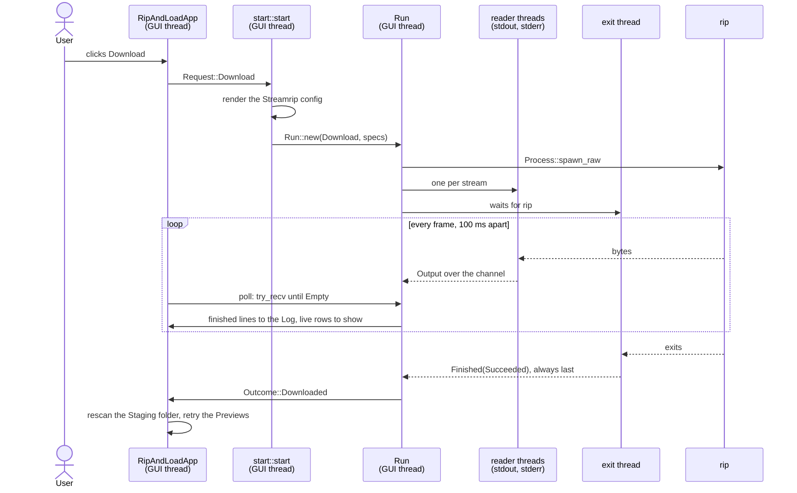

# Download

A Download runs streamrip's `rip` on the pasted URLs. `rip` logs in to the
Source, fetches the files and writes them into the Staging folder. The app
builds the command line, starts `rip`, and shows what it prints while it
runs, progress bars included.

This is the pipeline the others link back to for processes, threads and
channels. Every Run starts a process the same way, and the GUI follows it
the same way.

Run, Source, Staging folder and the other capitalised terms are defined in
the [glossary](../../../GLOSSARY.md).



## The examples

- **A**, the Qobuz album from URL recognition and Preview,
  `https://open.qobuz.com/album/0060254735180`, downloaded on Linux. One
  URL, no Quality override, and the Streamrip config is already there. It
  goes through every step and ends with the files in the Staging folder.
- **B**, the same Download on Windows. The tools run inside WSL, so the
  paths and the command line change.
- **C**, a Download that can't start, because the Streamrip config was
  edited by hand and isn't valid TOML any more.
- **D**, B cancelled halfway.

## Example A, step by step

### 1. The click

The function is **`download_tab::show`**, in
`crates/ripandload/src/download_tab.rs`. The app calls it on every frame
while the Download tab is open.

The Download button is enabled only when no Run is going, at least one URL
is pasted, and every pasted URL is recognised:

```rust
let can_download = !run_going && !urls.is_empty() && all_known;
if ui
    .add_enabled(can_download, egui::Button::new("Download"))
    .clicked()
{
    action = Action::Download;
}
```

The tab doesn't start anything. It returns what was clicked, an `Action`.
The app, in `RipAndLoadApp::ui` in `crates/ripandload/src/app.rs`, turns
`Action::Download` into a `Request` and calls `start_run`.

A `Request` is the Run the user asked for, with what the Settings don't
hold. For a Download, that is the URLs and the Quality picked on the tab.
For A:

```text
Download { urls: ["https://open.qobuz.com/album/0060254735180"], quality: None }
```

`None` means "From Settings": each Source's Quality from the Settings.

### 2. Starting the Run

The function is **`start::start`**, in
`crates/ripandload-core/src/start.rs`. `start_run` calls it on the GUI
thread, with the Settings as edited, the `Request`, the app's `Places`, and
the Log.

`Places` says where the Streamrip config lives and where it can be seeded
from. The app builds it once, at start-up, with `Places::standard`. Tests
point it at a temporary folder instead.

`start` works out where the tools run, with `ToolEnv::from_settings`, then
calls `start_in`. That clears the Log first, so each Run starts with an
empty one. Then it builds the Run:

```rust
log.clear();
match kind_and_commands(&tool_env, settings, request, places, log) {
    Ok((kind, specs)) => return Ok(Run::new(kind, tool_env, specs, log)),
    Err(cant) => {
        let message = format!("✗ {}", error_chain(&cant));
        // …
```

`start` gives back a `Result`: the started Run, or a `CantStart` saying why
it can't. Whatever goes wrong before the first process spawns is a
`CantStart`, and then no Run exists. Example C shows that path.

A `ToolEnv` says where the tools run. On Linux it is
`ToolEnv::Native { rip: None }`: run the tools directly, and look `rip` up
on `PATH`, since the Settings name no path for it.

> **Rust:** `?` after a call that returns a `Result` hands an error straight
> back to the caller. `kind_and_commands` uses it on every step that can
> fail, so each failure becomes the `Err(cant)` above.
> → [primer: `Result`, `?` and error enums](../rust-primer.md#result-and-error-enums)

### 3. The Streamrip config gets ready

The function is **`streamrip_config_ready`**, in `start.rs`.
`kind_and_commands` calls it for a Download, before anything else.

The Streamrip config is the config file `rip` reads. The app owns it
([ADR 0002](../../adr/0002-app-owned-streamrip-config.md)): it rewrites the
keys it manages from the Settings before every Download, with
`streamrip_config::render`. Which keys those are, and how a first config is
seeded, is the [Settings round-trip](settings.md).

```rust
let seeded = streamrip_config::render(config, places.personal.as_deref(), settings, tool_env)?;
// …
// The paths inside the Streamrip config are already as `rip` sees them,
// so the config's own path has to be too.
return Ok(tool_env.tool_path(config)?);
```

`render` gives back how the file came to be. For A it existed already, so
the answer is `Seeded::AlreadyThere`, and the Log gets nothing. A new file
would add a line such as
`Created the Streamrip config at … from your personal streamrip config`.

Then `tool_path` gives the config's path as `rip` will see it. Natively,
that is the path unchanged. For A:
`"/home/ana/.config/ripandload/streamrip.toml"`.

**Why seeding blocks the GUI once.** On the very first Download, with no
personal streamrip config to copy, `render` has `rip` write its default
config. It runs `rip --config-path … config path` and waits for it, with
`Command::output`, here on the GUI thread. The window doesn't redraw until
`rip` is done. That happens once, before any Run exists, so it isn't a
`Process` and it isn't followed like one.

### 4. The command line

The function is **`Download::new`**, in
`crates/ripandload-core/src/run/download.rs`. `kind_and_commands` calls it
with the config's path from step 3, the URLs and the Quality. It builds the
one command a Download runs, with **`command::download_spec`**, in
`crates/ripandload-core/src/command.rs`:

```rust
let mut spec = CommandSpec::new(Tool::Rip, &["--config-path", config]);
if let Some(quality) = quality {
    spec.args.extend(["-q".to_owned(), quality.to_string()]);
}
spec.args.push("url".to_owned());
spec.args.extend(urls.iter().map(|url| url.to_string()));
spec.env = [
    ("FORCE_COLOR", "1".to_owned()),
    // …
```

A `CommandSpec` is a command line as a plain value: which tool, its
arguments, and the environment variables to add. It doesn't say where the
tool is, or whether it runs inside WSL. Step 5 decides that. So the same
spec runs natively and inside WSL. For A:

```text
CommandSpec {
    program: Rip,
    args: ["--config-path", "/home/ana/.config/ripandload/streamrip.toml",
           "url", "https://open.qobuz.com/album/0060254735180"],
    env: [("FORCE_COLOR", "1"), ("TTY_COMPATIBLE", "1"),
          ("TTY_INTERACTIVE", "1"), ("COLUMNS", "100")],
}
```

Shown the way it would be typed, its `Display` form:

```text
rip --config-path /home/ana/.config/ripandload/streamrip.toml url https://open.qobuz.com/album/0060254735180
```

There is no `-q`, because the Quality is `None`. A Quality picked on the tab
would add `-q 3`, say, for every Source in this Download.

**Why the environment.** `rip` draws its progress bars with rich, a Python
library. rich draws none when its output is a pipe rather than a terminal,
and here it is a pipe. `FORCE_COLOR` makes rich 13, the version streamrip
2.2.0 pins, draw them anyway. `TTY_COMPATIBLE` and `TTY_INTERACTIVE` do the
same for rich 14 and later. `COLUMNS` makes them 100 characters wide.

`Download::new` gives back the kind and its commands:
`(Download { stdout: LiveOutput, stderr: LiveOutput }, [spec])`. What the
two `LiveOutput`s are for is step 7a.

### 5. Spawning

The function is **`Run::new`**, in `crates/ripandload-core/src/run.rs`.
`start_in` calls it with the kind, the `ToolEnv` and the specs. It sets up
the queue and calls **`start_next`**:

```rust
while let Some(spec) = self.queue.pop_front() {
    tracing::info!("$ {spec}");
    log.push(format!("$ {spec}"));
    let spawn = if self.kind.reads_raw(&spec) {
        Process::spawn_raw
    } else {
        Process::spawn
    };
    let process = self
        .tool_env
        .command(&spec)
        // …
```

The command line goes into the Log as `$ rip --config-path … url …`. It
also goes to the log file, through `tracing`.

Then the kind decides how the output is read. Most commands are read line
by line, with `Process::spawn`. `rip` redraws its progress bars without
ending a line, so a Download asks for the raw bytes, with
`Process::spawn_raw`.

`ToolEnv::command`, in `crates/ripandload-core/src/tool_env.rs`, turns the
spec into a `std::process::Command`. Natively, it finds `rip` on `PATH`,
adds the arguments and the environment, then:

```rust
command
    .stdin(Stdio::null())
    .stdout(Stdio::piped())
    .stderr(Stdio::piped());
no_window(&mut command);
```

stdin is empty, so a tool that asks a question fails instead of waiting
forever. stdout and stderr are pipes the app reads. On Windows, no console
window opens over the GUI.

If `rip` isn't on `PATH`, or can't be started, the Log gets a `✗` line and
the Run is over at once. Otherwise `start_next` keeps the spec and its
`Process` as the current command, and returns. The Status bar now reads
`Download: running rip --config-path … url ……`.

> **Rust:** the Run holds its kind as a `Box<dyn Kind>`. `Kind` is a trait
> that each kind of Run implements, `Download` here. Calls such as
> `self.kind.reads_raw(&spec)` go to whichever kind it is, and the methods a
> kind doesn't write keep the trait's defaults.
> → [primer: traits and default methods](../rust-primer.md#traits-and-default-methods)

### 6. The process's threads

The function is **`Process::spawn_with`**, in
`crates/ripandload-core/src/process.rs`. `spawn_raw` calls it with
`forward_chunks`, the function that reads one stream.

It starts `rip`, then three threads. A thread is needed for each because
reading a pipe, or waiting for a process, blocks. The GUI thread must never
block, or the window freezes.

- **Two reader threads**, one for stdout and one for stderr. Each reads
  whatever its pipe has, up to 4 KiB at a time, and sends it on as a
  `ProcessEvent::Output`, tagged with its stream. It ends when the pipe
  closes.
- **One exit thread.** It waits for `rip` to exit, then for both readers to
  finish, and sends `ProcessEvent::Finished` last.

All three send on one `mpsc` channel. Each thread holds a copy of its
`Sender`. The `Process` keeps the `Receiver`, the only end the GUI sees.

```rust
let (sender, events) = mpsc::channel();
// … a reader per piped stream, each with `sender.clone()`
let cancelled = Arc::new(AtomicBool::new(false));
let flag = Arc::clone(&cancelled);
thread::spawn(move || {
    let mut exit = wait(&mut child, &flag);
    // …
    let _ = sender.send(ProcessEvent::Finished(exit));
});
```

The exit thread can't just block in `wait` until `rip` exits, because
Cancel has to reach it. So `wait` checks every 20 ms (`POLL_INTERVAL`):
has `rip` exited, and has the `cancelled` flag been set? Example D sets it.

`Finished` is always the last event. The exit thread waits for the readers
before sending it, so every byte of output arrives first. That is what lets
the Run treat `Finished` as the end.

A `ProcessEvent` is one of three things. `Output` holds the next bytes of
one stream, as they came. `Line` holds one line, from a command read with
`Process::spawn`. `Finished` holds how the process ended, as an `Exit`:
`Succeeded`, `Failed { code }` or `Cancelled`. For A, the first event might
be:

```text
Output { stream: Stdout, bytes: [27, 91, 50, 59, 51, 54, 109, …] }
```

The bytes are rich's colours and text, cut wherever the read happened to
stop.

> **Rust:** the `cancelled` flag is shared between the `Process` on the GUI
> thread and the exit thread. `Arc` lets both own it. `AtomicBool` lets one
> thread set it while the other reads it, without a lock.
> → [primer: threads and `Arc<AtomicBool>`](../rust-primer.md#threads-and-arcatomicbool)

### 7. Each frame

The function is **`RipAndLoadApp::poll_run`**, in `app.rs`. The app calls
it first thing on every frame. It calls **`Run::poll`**, in `run.rs`, which
empties the channel:

```rust
while let Some((_, process)) = &self.current {
    let event = match process.events().try_recv() {
        Ok(event) => event,
        Err(TryRecvError::Empty) => break,
        // The exit thread died without saying how it ended.
        Err(TryRecvError::Disconnected) => {
            ProcessEvent::Finished(Exit::Failed { code: None })
        }
    };
    match event {
        // …
        ProcessEvent::Output { stream, bytes } => {
            for line in self.kind.on_output(stream, &bytes) {
                self.on_line(line, log);
            }
        }
```

`try_recv` takes the next event if there is one, and says `Empty` if there
isn't. It never waits. So `poll` handles everything that arrived since the
last frame, then returns.

`Output` bytes go to the kind, `Download::on_output`. It feeds them to the
`LiveOutput` of their stream, which gives back the lines now finished (step
7a). Each finished line goes through `on_line` to the Log, and to the log
file through `tracing`. Download's lines go in as they are.

While `rip` runs, `poll_run` asks for another frame in 100 ms
(`RUN_POLL_INTERVAL`):

```rust
run.poll(&mut self.log);
self.status = run.status();
if !run.is_finished() {
    ctx.request_repaint_after(RUN_POLL_INTERVAL);
    return;
}
```

**Why ask for frames.** egui only draws a frame when something happens,
such as a mouse move. The process's threads can't wake it: they know
nothing about the GUI. So the GUI wakes itself, ten times a second, for as
long as the Run goes. → [architecture: the immediate-mode GUI loop](../architecture.md#the-immediate-mode-gui-loop)

The same frame draws the Live display, the rows that show `rip`'s progress
bars. `RipAndLoadApp::ui` asks the Run for `Run::live_rows` and draws them
in a panel between the Log and the tab. They never go into the Log.

> **Rust:** `try_recv` is how the GUI thread hears from other threads
> without ever stopping a frame. `Empty` and `Disconnected` are the two ways
> it can find nothing.
> → [primer: channels](../rust-primer.md#channels-and-try_recv)

### 7a. LiveOutput

The type is **`LiveOutput`**, in `crates/ripandload-core/src/live_output.rs`.
A Download has one for stdout and one for stderr, so a chunk of one stream
never lands in the middle of a line of the other.

rich draws its progress bars in place, the way a terminal shows them. It
hides the cursor, then draws a few rows. Ten times a second it redraws
them. It goes back to the start of the row (`\r`), clears it (`ESC[2K`),
moves up a row (`ESC[1A`) and clears that, and so on, then draws the rows
again. A log message is printed the same way: in place of the bars, with
the bars drawn again below it. When the bars are done, rich shows the
cursor again.

`LiveOutput` replays this on a grid of rows, like a terminal would. It
splits the grid in two:

- **Finished lines.** A row above where the last redraw started writing
  will never change again. It goes to the Log.
- **Live rows.** The rows from there down are the Live display. They are
  only shown, never logged. When the cursor shows again (`ESC[?25h`), the
  display is over, and they are dropped.

Here is a small example, with rich's colours left out. It comes in four
chunks, as four reads might bring it.

1. `Logging in\n`, then `ESC[?25l` (hide the cursor, so the display
   starts), then `Discovery\n01. One More Time 25%`.
2. A redraw: `\r ESC[2K ESC[1A ESC[2K`, then
   `Discovery\n01. One More Time 50%`.
3. A redraw that prints a log message above the bars:
   `\r ESC[2K ESC[1A ESC[2K`, then
   `Track 03 not available\nDiscovery\n01. One More Time 50%`.
4. A last redraw with the bars gone, and the cursor shown again:
   `\r ESC[2K ESC[1A ESC[2K`, then `Discovery\n`, `ESC[?25h`,
   `Finished\n`.

After each chunk, `feed` returns the lines now finished, and `live_rows`
shows the Live display:

```text
1. feed → ["Logging in"]
   live_rows → ["Discovery", "01. One More Time 25%"]
2. feed → []
   live_rows → ["Discovery", "01. One More Time 50%"]
3. feed → []
   live_rows → ["Track 03 not available", "Discovery", "01. One More Time 50%"]
4. feed → ["Track 03 not available", "Finished"]
   live_rows → []
```

After chunk 3, the message is still a live row. Nothing yet says it won't be
drawn over. Only the next redraw, which starts writing below it, makes it
finished. In chunk 4, `ESC[?25h` drops the live rows, so the last
`Discovery` never reaches the Log.

The decision is made where a redraw writes its first character:

```rust
fn put(&mut self, c: char) {
    if std::mem::take(&mut self.redrawing) && self.live_top.is_some() {
        self.live_top = Some(self.row);
    }
    // …
```

`live_top` is the row the Live display starts at. Every row above it is
finished, and `feed` hands those out.

A chunk can end anywhere, even in the middle of an escape sequence or a
UTF-8 character. `feed` keeps that start and reads it again in front of the
next chunk.

### 8. The end

`rip` exits with status 0. The exit thread waits until both readers have
sent their last bytes, then sends `Finished(Succeeded)`.

On the next frame, `Run::poll` meets it:

```rust
ProcessEvent::Finished(exit) => {
    for line in self.kind.finish_output() {
        self.on_line(line, log);
    }
    self.on_finished(exit, log);
}
```

`Download::finish_output` hands over what's left on stdout, then stderr: a
last line without a `\n`, say. A Live display that never ended is dropped
there.

`on_finished` takes the current command away and logs how it ended. Success
logs nothing for a Download. Then it calls `start_next`. The queue is
empty, so the Run is over, and its kind gives the Outcome:

```rust
self.outcome = Some(self.kind.outcome(self.succeeded()));
```

An `Outcome` is what a finished Run leaves for the app to catch up with.
For a Download it is always `Outcome::Downloaded`.

The Status bar reads `Download finished`. Other Runs say `all good`
instead. A Download says `finished`, because its kind's `says_finished`
returns `true`.

A failure would be different. If `rip` exited with status 1, the Log would
get `✗ rip --config-path … failed with exit code 1`, the problem would be
counted, and the Status bar would read `Download: 1 problem, see the log`.

### 9. Catching up

The function is **`RipAndLoadApp::run_finished`**, in `app.rs`. `poll_run`
calls it once, on the frame the Run ends.

```rust
// Downloads and Uploads change what's in the Staging folder.
self.staging_scan.invalidate();
let Some(outcome) = self.run.as_mut().and_then(Run::take_outcome) else {
    return;
};
match outcome {
    // A Download may have written the Qobuz `app_id` that the
    // Previews need.
    Outcome::Downloaded => self.download.retry_previews(),
    // …
```

First it marks the Staging folder for a rescan. The Upload tab reads it
again the next time it's drawn, and finds the album's files.

Then `take_outcome` hands over the Outcome, once. For `Downloaded`, the app
retries the Previews that failed. A first Qobuz Download is what makes
streamrip write the Qobuz `app_id` into the Streamrip config. A Qobuz URL
that said "no preview until the first Qobuz Download" can now get its
Preview. → [URL recognition: example D](url-recognition.md#example-d-before-the-first-qobuz-download)

**Why always `Downloaded`.** A Download that failed or was cancelled may
still have written files into the Staging folder, or the `app_id` into the
Streamrip config. So the app catches up after any Download, however it
went.

## Example B: the same Download inside WSL

On Windows, every tool runs inside a WSL distro
([ADR 0001](../../adr/0001-windows-tools-run-in-wsl.md)). Say the Settings
name the `Debian` distro, and no path for `rip`.

Steps 1 and 2 go as for A, except that `ToolEnv::from_settings` gives
`ToolEnv::Wsl { distro: Some("Debian"), rip: None }`.

> **Rust:** `from_settings` decides with `cfg!(windows)`, which is `true`
> only in the Windows build.
> → [primer: `cfg`](../rust-primer.md#cfg)

In step 3, the Streamrip config is at
`C:\Users\ana\AppData\Roaming\ripandload\config\streamrip.toml`. `rip`
inside WSL can't read a Windows path. `tool_path` turns it into the path
WSL mounts it at, with `wsl_path::to_wsl_path`:
`"/mnt/c/Users/ana/AppData/Roaming/ripandload/config/streamrip.toml"`.
`render` writes the paths inside the config the same way.

In step 4, the `CommandSpec` is the same as A's, with that path. It knows
nothing about WSL.

In step 5, `ToolEnv::command` builds a different process. It runs
`wsl.exe`, which runs `rip` inside the distro:

```rust
let mut command = wsl_exec(distro.as_deref());
if !spec.env.is_empty() {
    command.arg("env");
    command.args(spec.env.iter().map(|(key, value)| format!("{key}={value}")));
}
command
    .args(["sh", "-c", WSL_WRAPPER, program])
    .args(&spec.args);
```

For B the whole command line is:

```text
wsl.exe -d Debian --exec env FORCE_COLOR=1 TTY_COMPATIBLE=1 TTY_INTERACTIVE=1 COLUMNS=100
    sh -c <WSL_WRAPPER> ~/.local/share/ripandload/venv/bin/rip
    --config-path /mnt/c/Users/ana/AppData/Roaming/ripandload/config/streamrip.toml
    url https://open.qobuz.com/album/0060254735180
```

- `--exec` runs the program directly, not through the user's shell, so the
  arguments arrive exactly as given.
- `env` sets the spec's variables inside WSL, right before the wrapper.
  `wsl.exe` itself gets one more, `WSL_UTF8=1`, so its own messages come in
  UTF-8.
- `rip` is the venv the WSL setup steps create, since the Settings name no
  path.
- `WSL_WRAPPER` is a short `sh` script. It writes its process ID to
  `/tmp/ripandload.pid`, sets `RIPANDLOAD_PROCESS=1`, expands the leading
  `~/`, and `exec`s `rip`. `exec` keeps the process ID, so the one recorded
  is `rip`'s. Example D uses both.

The Log still shows the spec, `$ rip --config-path /mnt/c/… url …`, not
the `wsl.exe` line.

Steps 6 to 9 go as for A. The threads read `wsl.exe`'s pipes, which carry
`rip`'s output.

## Example C: a Streamrip config that isn't TOML

Say the Streamrip config was edited by hand and a quote went missing.

Steps 1 and 2 go as for A. In step 3, `render` finds the file there, so it
seeds nothing. Then it parses the file, and that fails with a
`StreamripConfigError::Parse`. The `?` after `render` turns it into a
`CantStart::StreamripConfig` and returns it from `kind_and_commands`.

Back in `start_in`, the `Err` arm runs. It clears the Log again and writes
one line, the whole chain of errors after a `✗`:

```text
✗ couldn't get the Streamrip config ready: the Streamrip config /home/ana/.config/ripandload/streamrip.toml isn't valid TOML; fix it, or delete it and the next Download makes a new one: …
```

The `…` is the TOML parser's own message, with the line it choked on.

`start` returns the `CantStart`. `start_run` puts the same chain in the
Status bar and returns. No Run exists, nothing is spawned, and no Outcome
comes, so the Previews aren't retried.

The Log is cleared a second time on purpose. A line such as `Created the
Streamrip config at …`, written before the failure, would only distract
from the reason.

There is no check that the Credentials are filled in. With empty
Credentials, `rip` starts, fails to log in, and exits with an error, which
step 8 reports like any failure.

## Example D: Cancel, inside WSL

Steps 1 to 6 go as for B. `rip` is downloading, and the Status bar reads
`Download: running rip …`, with a spinner and a Cancel button beside it.
The tab's own Cancel button is enabled too.

The user clicks Cancel. The tab returns `Action::Cancel`, and the app calls
`cancel_run`. That calls **`Run::cancel`**, in `run.rs`:

```rust
self.cancelled = true;
self.queue.clear();
if let Some((_, process)) = &self.current {
    process.cancel();
    if let Some(mut kill) = self.tool_env.cancel_command()
        && let Err(err) = kill.spawn()
    {
        // … a ⚠ line in the Log
```

Three things happen.

1. The Run remembers it was cancelled, and drops the rest of the queue.
   A Download has nothing left in it, but other Runs do.
2. `Process::cancel` sets the `cancelled` flag from step 6. Within 20 ms
   the exit thread sees it, kills `wsl.exe`, and sends
   `Finished(Cancelled)`. It doesn't wait for the readers this time: a
   process inside WSL may still hold the pipes open.
3. Killing `wsl.exe` doesn't always stop `rip` inside WSL. So
   `ToolEnv::cancel_command` starts a second `wsl.exe`, running the
   `KILL_RECORDED` script. It reads the process ID the wrapper recorded,
   checks that the process still has `RIPANDLOAD_PROCESS=1` (a finished
   tool's ID may belong to something else by now), and sends `TERM` to its
   children and to it. Natively there is no such command: killing the
   process is enough.

If that second `wsl.exe` can't even start, the Log gets
`⚠ couldn't stop the tool inside WSL, which may keep running: …`. The Run
still counts as cancelled, and the line isn't counted as a problem.

On the next frame, `Run::poll` meets `Finished(Cancelled)`.
`finish_output` drops the Live display that never ended, so the half-drawn
bars never reach the Log. `on_finished` logs `Cancelled.`. The queue is
empty, so the Run is over.

The Status bar reads `Download cancelled`. The Outcome is still
`Downloaded`, and step 9 runs as for A: `rip` may have written some files
before it was stopped.

## Where the threads are

- **The GUI thread** runs steps 1 to 5, the polling in 7 and 8, and step 9.
  It never waits on `rip`. The one exception is seeding a first Streamrip
  config in step 3, which waits for `rip` before any Run exists.
- **Each process gets one reader thread per piped stream**, two for `rip`.
  They are started in `spawn_with` and never joined. Each ends when its
  pipe closes, or when nobody listens any more.
- **Each process gets one exit thread.** It waits for the process, then for
  the readers, and always sends `Finished` last. On Cancel it kills the
  process and stops waiting for the readers.
- **There is one channel per process.** The reader threads and the exit
  thread each hold a `Sender`. The `Process`, inside the Run, holds the
  `Receiver`. The GUI only ever calls `try_recv` on it.
- **A `Disconnected` channel counts as `Failed { code: None }`.** It means
  the exit thread is gone without saying how the process ended. The Log
  gets `✗ rip … ended without an exit code`.
- **Dropping a `Process` cancels it.** Its `Drop` sets the `cancelled` flag,
  so the exit thread kills the OS process it started. A Run dropped while
  `rip` is going doesn't leave that process running. Inside WSL that
  process is `wsl.exe`: only `Run::cancel` also runs `KILL_RECORDED`.

> **Rust:** `Drop` is code that runs when a value goes away, like a
> destructor in C++.
> → [primer: `Drop`](../rust-primer.md#drop)

Every other pipeline runs its commands this way. Upload, Compare with
Server, Test connection and Check tools read their output line by line,
with `Process::spawn`, but the threads, the channel and the polling are the
same. [URL recognition and Preview](url-recognition.md#where-the-threads-are)
uses the simplest case of the pattern, without a `Process`.

The Run and Process tests play `rip` with small `sh` scripts (`fake-rip.sh`
and `script-rip.sh` in `crates/ripandload-core/tests/fixtures/`), so they
run natively, on Unix only. The WSL tests only look at the command lines
built.

Tested by: `crates/ripandload-core/tests/run.rs`
(`first_download_creates_the_streamrip_config_and_runs_rip`,
`later_download_says_nothing_about_the_streamrip_config`,
`failed_download_reports_the_exit_code`, `cancel_stops_rip_and_skips_the_rest`),
`crates/ripandload-core/tests/process.rs`
(`raw_output_arrives_without_waiting_for_a_newline_and_says_which_stream`,
`cancel_stops_the_process`,
`cancel_works_while_a_grandchild_holds_the_output_open`),
`crates/ripandload-core/tests/live_output.rs`
(`log_lines_come_out_and_progress_does_not`,
`live_rows_show_the_whole_latest_frame`),
`crates/ripandload-core/src/run/download.rs` (`stdout_gives_live_rows_until_finished`,
`always_downloaded`), `crates/ripandload-core/src/command.rs`
(`download_spec_makes_rich_draw_progress_bars_into_a_pipe`,
`download_spec_passes_a_quality_override`),
`crates/ripandload-core/src/start.rs`
(`download_with_a_broken_streamrip_config_cant_start`) and
`crates/ripandload-core/src/tool_env.rs`
(`wsl_passes_the_spec_env_through_env`,
`wsl_cancel_kills_the_recorded_process_without_the_wrapper`).
