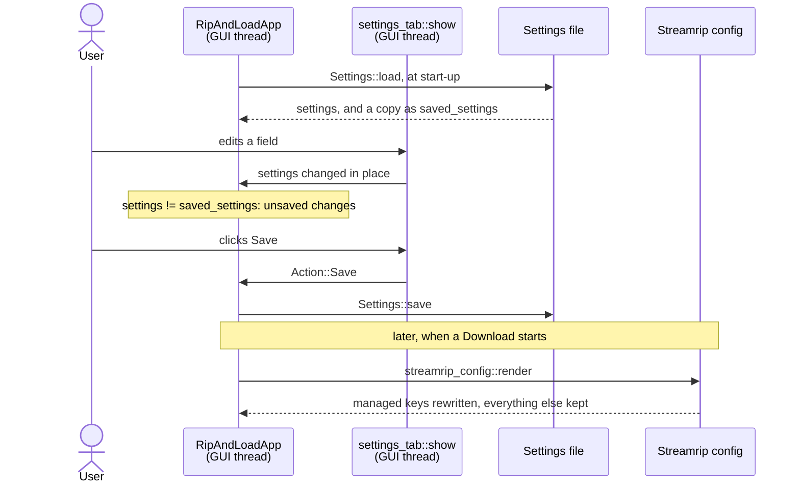

# Settings round-trip

The Settings are everything the user configures: Credentials, Quality,
Naming templates, the Staging folder, the Server, and where the tools are.
They make two trips.

1. **Between the Settings file and the app.** The app loads the Settings
   file when it starts. The Settings tab edits the Settings in memory. Save
   writes them back to the file.
2. **From the Settings to the Streamrip config.** `rip` doesn't read the
   Settings file. It reads the Streamrip config, the app's own config file
   for streamrip. Before every Download, the app copies the Settings that
   streamrip needs into it.

The two trips are separate. Saving doesn't touch the Streamrip config, and
a Download uses the Settings as edited, saved or not.

Settings, Settings file, Streamrip config, Credentials and the other
capitalised terms are defined in the [glossary](../../../GLOSSARY.md). Where
each file lives is in
[architecture: files on disk](../architecture.md#files-on-disk).



## The examples

- **A**, the app starts with an existing Settings file. The user raises the
  Qobuz Quality and shortens the folder Naming template, and saves. The next
  Download renders them into a Streamrip config that the user once edited by
  hand. It goes through both parts.
- **B**, a first start on Linux, with no files at all. The first Download
  creates the Streamrip config from the user's personal streamrip config.
- **C**, a save with a problem: the Staging folder is left empty. Save still
  writes it. C also quits with unsaved changes.
- **D**, a Settings file that isn't valid TOML. The app starts on the
  defaults.

A is followed step by step below. B, C and D come after it, and only tell
where they differ.

## Part 1: the Settings file and the app

### 1. Loading

The function is **`Settings::load`**, in
`crates/ripandload-core/src/settings.rs`. `RipAndLoadApp::new`, in
`crates/ripandload/src/app.rs`, calls it once, at start-up, with the path
from `Settings::default_path`. On Linux that is
`/home/ana/.config/ripandload/settings.toml`.

For A, the file holds:

```toml
staging_folder = "/home/ana/Music/ripandload"
offer_clear_after_upload = true
active_server = 0

[qobuz]
user_id = "1234567"
auth_token = "token"

[deezer]
arl = ""

[quality]
qobuz = 3
deezer = 2

[naming]
folder = "{albumartist} - {title} ({year}) [{container}] [{bit_depth}B-{sampling_rate}kHz]"
track = "{tracknumber:02}. {artist} - {title}{explicit}"

[[servers]]
host = "music.example.org"
user = "ana"
port = 22
music_folder = "/srv/music"
ssh_key = "/home/ana/.ssh/ripandload"
```

`load` reads the file and hands the text to the `toml` crate:

```rust
let text = match fs::read_to_string(path) {
    Ok(text) => text,
    Err(err) if err.kind() == std::io::ErrorKind::NotFound => return Ok(Self::default()),
    // …
};
toml::from_str(&text).map_err(|source| SettingsError::Parse {
```

`toml::from_str` turns the text into a `Settings` value. It knows the
layout because `Settings` says it can be read and written:

```rust
#[derive(Debug, Clone, PartialEq, Serialize, Deserialize)]
#[serde(default)]
pub struct Settings {
    /// The Qobuz Credentials.
    pub qobuz: QobuzCredentials,
    // …
```

`Serialize` and `Deserialize` come from serde. They write the code that maps
each field to a TOML key of the same name: `qobuz` to `[qobuz]`, and so on.
The Credentials, Quality, Naming templates and Server are structs of their
own, `QobuzCredentials`, `QualityDefaults` and the rest, each a table in the
file.

`#[serde(default)]` makes every key optional. A key missing from the file
takes its value from `Settings::default()`. So a file saved by an older
version, before a Setting existed, still loads.

**Why `empty_path_is_none`.** One older version saved a Server with no SSH
key as `ssh_key = ""`. Today that field is an `Option<PathBuf>`, `None`
when no key is set. `ssh_key` is read through `empty_path_is_none`, which
turns an empty path into `None`, so the old file means what it always
meant.

`RipAndLoadApp::new` keeps two copies of what was loaded:

```rust
saved_settings: settings.clone(),
settings,
```

`settings` is what the Settings tab edits, and what every Run uses.
`saved_settings` is the Settings as last loaded or saved.

> **Rust:** `#[derive(...)]` asks the compiler to write the code for a list
> of traits. `Serialize` and `Deserialize` are serde's, and are how the
> struct is read from TOML and written back.
> → [primer: derive, the `Debug` form, and serde](../rust-primer.md#derive-the-debug-form-and-serde)

### 2. Editing

The function is **`settings_tab::show`**, in
`crates/ripandload/src/settings_tab.rs`. The app calls it on every frame
while the Settings tab is open, with `&mut self.settings`.

Every field edits the Settings in place, as the user types. There is no
form copy to apply. For A, the user picks Qobuz Quality 4, and shortens the
folder Naming template to `{albumartist} - {title} ({year})`. From that
frame on, `settings.quality.qobuz` is `4`.

Path fields, such as the Staging folder and the SSH key, are `PathPicker`s,
in `crates/ripandload/src/path_picker.rs`: a text box and a Browse… button.

### 3. Problems

Still in **`settings_tab::show`**. Every frame, before drawing the form, it
asks the Settings what's wrong with them:

```rust
if let Err(problems) = settings.validate() {
    for problem in problems {
        ui.colored_label(ui.visuals().warn_fg_color, format!("⚠ {problem}"));
    }
}
```

**`Settings::validate`**, in `settings.rs`, lists everything that would
make a Download or an Upload fail: a Quality level the Source doesn't have,
an empty Naming template, an empty Staging folder, no active Server, port 0.
Each is a `SettingsProblem`. For A there is none, so no line is drawn.

These lines are only shown. Nothing else reads them. Example C is why.

### 4. Unsaved changes

The function is **`RipAndLoadApp::has_unsaved_changes`**, in `app.rs`:

```rust
fn has_unsaved_changes(&self) -> bool {
    self.settings != self.saved_settings
}
```

The Settings as edited are compared with the Settings as saved, field by
field. `Settings` derives `PartialEq`, which writes that comparison.

The app passes the answer to `settings_tab::show` as `unsaved`. The tab
enables Save only then, and shows `• unsaved changes` beside it. For A,
after the edits in step 2, both show.

Changing a value and changing it back counts as no change: the two copies
are equal again.

### 5. Saving

The user clicks Save. The tab returns `Action::Save`, and the app calls
**`save_settings`**, in `app.rs`:

```rust
match self.settings.save(path) {
    Ok(()) => {
        self.saved_settings = self.settings.clone();
        self.status = format!("Settings saved to {}", path.display());
        true
    }
```

**`Settings::save`**, in `settings.rs`, turns the Settings into TOML with
`toml::to_string_pretty`, creates the folder if needed, and writes the
file whole. The file is the one shown in step 1, with `qobuz = 4` and the
new `folder` template.

The Status bar reads
`Settings saved to /home/ana/.config/ripandload/settings.toml`. The saved
copy is now the edited one, so Save is disabled again.

Nothing else happens. The Streamrip config isn't touched: Part 2 runs at
the next Download.

**Why the file is private.** The Settings file holds Credentials. So `save`
opens it with **`open_private`**, which on Unix makes it readable by its
owner only (mode 0600):

```rust
options.mode(0o600);
let file = options.open(path)?;
// `mode` only applies to a new file, so an existing one is fixed up
// here.
file.set_permissions(fs::Permissions::from_mode(0o600))?;
```

The mode given to `open` only counts when the file is new. A file that
already existed with a wider mode is narrowed by `set_permissions`. The
Streamrip config, which holds the same Credentials, is written the same
way. On Windows the file keeps the system's default permissions.

> **Rust:** that code sits inside a `#[cfg(unix)]` block. It's only
> compiled on Unix, where file modes exist.
> → [primer: `cfg`](../rust-primer.md#cfg)

## Part 2: the Settings to the Streamrip config

This part runs inside `start::start`, at the start of each Download, not on
Save. It is step 3 of the Download pipeline, in more detail.
→ [Download: the Streamrip config gets ready](download.md#3-the-streamrip-config-gets-ready)

**Why a Streamrip config of the app's own.** The user may already use
streamrip by hand, with a personal streamrip config. The app never edits
that file ([ADR 0002](../../adr/0002-app-owned-streamrip-config.md)). It
keeps its own next to the Settings file, at
`/home/ana/.config/ripandload/streamrip.toml`, and passes it to `rip` with
`--config-path`.

### 6. Rendering

The function is **`streamrip_config::render`**, in
`crates/ripandload-core/src/streamrip_config.rs`. `start::start` calls it
with the Streamrip config's path, the personal streamrip config's path, the
Settings as edited, and the `ToolEnv`:

```rust
let seeded = seed(config, personal, tool_env)?;

let text = String::from_utf8_lossy(&read(config)?).into_owned();
let mut doc: DocumentMut = text.parse().map_err(|source| StreamripConfigError::Parse {
```

It does four things.

1. **`seed`** creates the file if it doesn't exist yet. For A it does
   exist, so `seed` gives back `Seeded::AlreadyThere` and does nothing.
   Example B is the other case.
2. It reads the file and parses it with `toml_edit`, into a `DocumentMut`.
3. **`apply`** writes the managed keys from the Settings into it (step 7).
4. It writes the document back, with `write_private`, which uses
   `open_private` as in step 5.

**Why `toml_edit`, not `toml`.** The `toml` crate reads a file into plain
values and writes them back out fresh: comments, blank lines and key order
are lost. `toml_edit` keeps the document as it was written, and changes only
the values it's told to. The Streamrip config is a file the user may open
and edit, so it must stay readable. → [crates: toml_edit](../crates.md#toml_edit)

### 7. The managed keys

The function is **`apply`**, in `streamrip_config.rs`. It sets every key
the app manages, each with **`set_managed`**:

```rust
let staging = convert(&settings.staging_folder)?;
let downloads_db = convert(&db_dir.join("downloads.db"))?;
let failed_db = convert(&db_dir.join("failed_downloads.db"))?;

set_managed(doc, "qobuz", "use_auth_token", true);
set_managed(doc, "qobuz", "email_or_userid", &settings.qobuz.user_id);
// …
set_managed(doc, "qobuz", "quality", i64::from(settings.quality.qobuz));
// …
set_managed(doc, "filepaths", "folder_format", &settings.naming.folder);
// …
set_managed(doc, "downloads", "folder", staging);
// A `Qobuz/` or `Deezer/` folder in the Staging folder would be sent by
// the next Upload and show up in the Navidrome library.
set_managed(doc, "downloads", "source_subdirectories", false);
set_managed(doc, "database", "downloads_path", downloads_db);
```

The managed keys are the Credentials, the Quality per Source, the two
Naming templates, the Staging folder as the download folder, and two keys
the app always sets the same way. Every other key is the user's, or
streamrip's.

`set_managed` replaces the value of a key, and adds the key, or its whole
table, when it's missing. It keeps the comments around the old value.

Two of the fixed values have a reason:

- **`source_subdirectories = false`.** By default streamrip puts each
  Source's downloads in a `Qobuz/` or `Deezer/` folder. In the Staging
  folder, that folder would be uploaded too, and show up in the music
  server's library.
- **The databases next to the Streamrip config.** streamrip records what it
  has downloaded, and skips it next time. The app's databases are its own,
  `downloads.db` and `failed_downloads.db` in the same folder as the
  Streamrip config. So the app's Downloads never mix with the history of
  the user's own streamrip.

**Paths are converted first.** The Staging folder and the two databases are
paths `rip` must find. `convert` runs `tool_path` on each, as the Download
does for the config itself. Natively they are unchanged. Inside WSL, they
become `/mnt/c/…`. All three are converted before any key is set. If one
can't be, `apply` returns a `ManagedPath` error, and the document is left
untouched.

For A, the Streamrip config has been used before. streamrip wrote the
`app_id` into it. The user once added `max_connections`, with a comment,
and once changed `quality` by hand, to 2. Before `render`, in part:

```toml
[downloads]
folder = "/home/ana/Music/ripandload"
source_subdirectories = false
# Ana: three at a time, or the router gives up.
max_connections = 3

[qobuz]
# 1: 320kbps MP3, 2: 16/44.1, 3: 24/<=96, 4: 24/>=96
quality = 2
use_auth_token = true
email_or_userid = "1234567"
password_or_token = "token"
app_id = "950096963"

[filepaths]
folder_format = "{albumartist} - {title} ({year}) [{container}] [{bit_depth}B-{sampling_rate}kHz]"
track_format = "{tracknumber:02}. {artist} - {title}{explicit}"
```

After `render`, two lines differ:

```toml
quality = 4
```

```toml
folder_format = "{albumartist} - {title} ({year})"
```

Everything else is as it was:

- Ana's comment and `max_connections` stay. The app doesn't manage them.
- streamrip's comment above `quality` stays, though the value under it
  changed.
- `app_id` stays. streamrip owns it, and Qobuz Previews read it.
- The `quality` of 2, set by hand, is gone. A managed key always takes the
  Settings' value. To change it, the user changes the Settings.

`render` gives back `Seeded::AlreadyThere`, and the Download goes on.

## Example B: a first start, with no files

The app starts on Linux for the first time. There is no Settings file and no
Streamrip config.

In step 1, `fs::read_to_string` fails with `NotFound`. That isn't an error:
it's a first start. `load` gives back `Settings::default()`. The defaults
have empty Credentials, streamrip's own Quality and Naming templates, the
Staging folder `~/Music/ripandload`, and one empty Server. The Status bar
reads `Idle`, and nothing is written until the user saves.

The user fills in the Credentials and saves. Step 5 creates
`~/.config/ripandload/` and the Settings file in it.

At the first Download, in step 6, the Streamrip config doesn't exist, so
`seed` creates it:

```rust
if let Some(personal) = personal.filter(|personal| personal.is_file()) {
    let bytes = read(personal)?;
    write_private(config, &bytes)?;
    return Ok(Seeded::FromPersonal);
}
```

The user already has a personal streamrip config, at
`~/.config/streamrip/config.toml`. `seed` copies it, as it is, and only
reads the original. `apply` then overwrites the managed keys, so the copy
keeps the user's other choices with the app's Credentials, Quality and
folders.

`render` gives back `Seeded::FromPersonal`, and the Log reads
`Created the Streamrip config at /home/ana/.config/ripandload/streamrip.toml from your personal streamrip config`.

With no personal streamrip config, and always on Windows, `seed` has `rip`
write its default config instead, `Seeded::FromRip`. It waits for `rip` on
the GUI thread. If `rip` fails, or leaves no file, whatever it half wrote is
removed, so the next Download tries again.
→ [Download: why seeding blocks the GUI once](download.md#3-the-streamrip-config-gets-ready)

## Example C: a save with a problem

Steps 1 and 2 go as for A, except that the user empties the Staging folder's
text box.

In step 3, `validate` finds `SettingsProblem::EmptyStagingFolder`, and the
tab shows `⚠ no Staging folder is set` above the form.

In step 5, Save writes the file anyway, with `staging_folder = ""`.
`save_settings` never calls `validate`.

**Why save anyway.** Settings are often filled in over several sittings: a
Server today, the Credentials tomorrow. Refusing to save half-filled
Settings would lose what the user typed. The problem line stays at the top of the
tab until it's fixed.

**Quitting with unsaved changes.** Say the user edits a field again, then
closes the window without saving. Every frame, **`guard_close`**, in
`app.rs`, checks for that:

```rust
let close_requested = ctx.input(|input| input.viewport().close_requested());
if close_requested && self.has_unsaved_changes() && !self.close_anyway {
    ctx.send_viewport_cmd(egui::ViewportCommand::CancelClose);
    self.confirming_close = true;
}
```

The close is cancelled, and the "Unsaved changes" dialog opens, with three
buttons:

- **Save and quit** saves as in step 5, then quits. If the save fails, the
  window stays open, with the reason in the Status bar.
- **Quit without saving** quits.
- **Cancel**, Escape, or a click outside the dialog, closes the dialog and
  keeps the window open.

Quitting sets `close_anyway`, so the close that follows goes through.

## Example D: a Settings file that isn't TOML

Say the Settings file was edited by hand, and a closing quote went missing:

```toml
staging_folder = "/home/ana/Music
```

In step 1, `toml::from_str` fails, and `load` gives back a
`SettingsError::Parse`. `RipAndLoadApp::new` doesn't stop there:

```rust
Some(path) => Settings::load(path).unwrap_or_else(|err| {
    tracing::error!(error = %error_chain(&err), "couldn't load Settings");
    status = format!(
        "{}. Using defaults; saving will replace it.",
        error_chain(&err)
    );
    Settings::default()
}),
```

The app starts on the defaults. The error goes to the log file, and the
Status bar reads:

```text
Settings file /home/ana/.config/ripandload/settings.toml isn't valid: TOML parse error at line 1, column 34; invalid basic string, expected `"`. Using defaults; saving will replace it.
```

**Why start anyway.** An app that won't open can't help fix its own
Settings. Starting on the defaults lets the user fill the Settings in again,
or close the app and fix the file by hand. The Status bar says plainly that
the next save replaces the broken file.

## Where the threads are

Everything here runs on the GUI thread. `load` runs in `RipAndLoadApp::new`,
before the first frame. `save` runs in the frame that handles
`Action::Save`. `render` runs inside `start::start`, before the Download's
process starts, and on a first Download without a personal config that
includes waiting for `rip`.
→ [Download: where the threads are](download.md#where-the-threads-are)

Tested by: `crates/ripandload-core/src/settings.rs`
(`missing_file_gives_defaults`, `save_then_load_round_trips`,
`missing_keys_fall_back_to_defaults`, `empty_or_missing_ssh_key_loads_as_none`,
`invalid_file_is_a_parse_error`, `saved_file_is_private`, `defaults_are_valid`,
`blank_staging_folder_is_a_problem`, `quality_out_of_range_is_a_problem`),
`crates/ripandload-core/src/streamrip_config.rs`
(`existing_value_is_replaced`, `comment_above_the_key_is_kept`,
`other_keys_are_left_alone`, `missing_table_is_created`,
`wsl_gets_the_staging_folder_and_databases_as_mnt_paths`,
`wsl_staging_folder_off_a_drive_is_an_error`),
`crates/ripandload-core/tests/streamrip_config.rs`
(`seeded_from_personal_config_with_managed_keys_from_settings`,
`unmanaged_keys_and_comments_survive`, `personal_config_is_never_modified`,
`rendered_config_is_private`, `rendering_twice_is_idempotent`,
`existing_config_is_updated_not_reseeded`,
`without_a_personal_config_rip_creates_the_default`,
`half_written_default_is_removed_so_the_next_render_reseeds`) and
`crates/ripandload-core/tests/run.rs`
(`first_download_creates_the_streamrip_config_and_runs_rip`).
