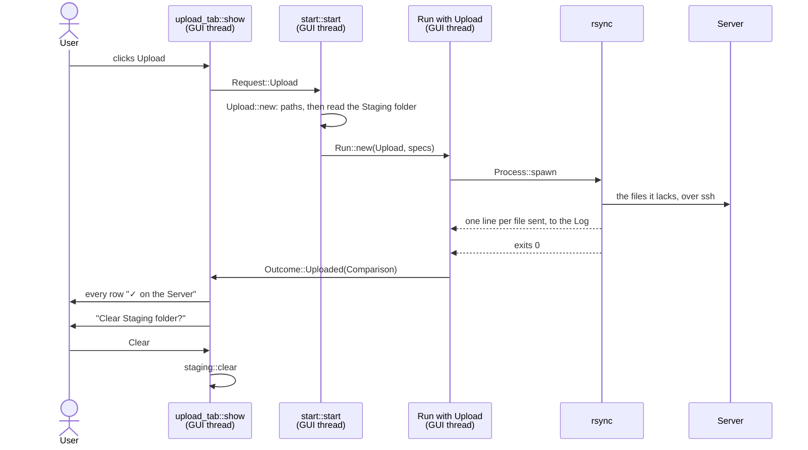

# Upload

An Upload sends the Staging folder to the Server with rsync. rsync sends
only what the Server lacks, and never deletes anything there. When it
succeeds, the Upload tab marks every Album folder as on the Server, and the
app offers to clear the Staging folder.

The Upload runs the same rsync command as
[Compare with Server](compare.md), without `--dry-run --itemize-changes`.
So the command line and the snapshot of the Staging folder are explained
there, and only linked to here. Processes, threads and Cancel work as in
the [Download](download.md).

Server, Staging folder, Album folder, Comparison and the other capitalised
terms are defined in the [glossary](../../../GLOSSARY.md).



## The examples

- **A**, on Linux. It carries on from
  [Compare's example A](compare.md#example-a-step-by-step): the same two
  Album folders, one already on the Server, one with 8 of its 11 tracks to
  send. rsync sends the 8 and the cover, both rows end `✓ on the Server`,
  and the user clears the Staging folder.
- **B**, A cancelled halfway. The app claims nothing about what reached the
  Server.
- **C**, a file copied into the Staging folder while the Upload runs. It
  still reads "to upload" afterwards.

Two more cases go exactly as for Compare with Server:

- **Inside WSL**, the SSH key is copied into WSL first, and the Staging
  folder goes to rsync as `/mnt/c/…`.
  → [Compare: example B](compare.md#example-b-the-same-compare-inside-wsl)
- **A Server that can't be reached** makes rsync exit with 255. The Log
  gets the same hint, `couldn't reach or log in to the Server; check its
  host, port, user and SSH key`, and the Outcome is `Nothing`.
  → [Compare: example C](compare.md#example-c-the-server-cant-be-reached)

  Any other failing exit code gets no hint. A folder on the Server the user
  can't write to makes rsync exit with 23, say, and the Log gets only
  `✗ rsync … failed with exit code 23`, after rsync's own lines saying
  which file. Only 255 has one clear cause worth a hint.

## Example A, step by step

The Settings are those of Compare's example A: the Staging folder
`/home/ana/Music/ripandload`, and the Server `music.example.org`, user
`ana`, port 22, music folder `/srv/music`, SSH key
`/home/ana/.ssh/ripandload`. A Compare with Server has just run, so the tab
reads:

```text
On the Server    8 to upload · 14 already on the Server (compared 2 min ago)

Björk - Debut (1993)         8 of 11 to upload
Zedd - True Colors (2015)    ✓ on the Server
```

### 1. The click

The function is **`upload_tab::show`**, in
`crates/ripandload/src/upload_tab.rs`. The Upload button is enabled just as
Compare with Server's is: no Run going, and an active Server that
`start::server` accepts.
→ [Compare: the click](compare.md#1-the-click)

```rust
let upload = ui
    .add_enabled(!run_going && server.is_ok(), egui::Button::new("Upload"))
    .on_hover_text(
        "Copies the Staging folder to the Server. Nothing on the Server is deleted.",
    );
```

Its hover text makes a promise: nothing on the Server is deleted. Step 3
is how that holds.

The tab returns `Action::Upload`, and the app calls `start_run` with
`Request::Upload`. An Upload doesn't need a Compare with Server first.

### 2. Starting the Run

The function is **`Upload::new`**, in
`crates/ripandload-core/src/run/upload.rs`. It does what `Compare::new`
does, in the same order: `ssh_ready`, then `tool_path` on the Staging
folder, then reading the Staging folder, last. The snapshot it reads is a
`StagingAtStart`, with the same 22 music files and 2 covers as Compare's.
→ [Compare: starting the Run](compare.md#2-starting-the-run)

### 3. The command line

The function is **`command::upload_spec`**, in
`crates/ripandload-core/src/command.rs`. Its arguments are
`command::rsync_args` and nothing else:

```rust
CommandSpec {
    program: Tool::Rsync,
    args: rsync_args(server, staging),
    env: Vec::new(),
}
```

In the Log, for A:

```text
$ rsync -rtv --partial --chmod=D755,F644 --8-bit-output -e ssh -i /home/ana/.ssh/ripandload -p 22 -o StrictHostKeyChecking=accept-new -o BatchMode=yes /home/ana/Music/ripandload/ ana@music.example.org:/srv/music/
```

What each part does is in Compare's step 3.
→ [Compare: the command line](compare.md#3-the-command-line)

**Why nothing is deleted.** There is no `--delete`. rsync adds files to
the music folder and updates changed ones, but never removes a file the
Staging folder doesn't have. The Server's music folder is usually the whole
library, and the Staging folder only what's new.

### 4. Spawning and polling

As for Compare with Server: rsync is started with `Process::spawn`, and its
output arrives as whole lines.
→ [Compare: spawning and polling](compare.md#4-spawning-and-polling)

The Status bar reads `Upload: running rsync -rtv …`.

### 5. Lines go to the Log

`Upload` keeps the default `Kind::on_line`, which writes every line to the
Log as it is. With `-v`, rsync names each file as it sends it. For A, the
Log reads something like:

```text
$ rsync -rtv --partial … ana@music.example.org:/srv/music/
sending incremental file list
Björk - Debut (1993)/
Björk - Debut (1993)/04. There's More to Life Than This.flac
Björk - Debut (1993)/05. Like Someone in Love.flac
…
Björk - Debut (1993)/11. The Anchor Song.flac
Björk - Debut (1993)/cover.jpg

sent 412,401,233 bytes  received 210 bytes  9,371,623.70 bytes/sec
total size is 798,113,342  speedup is 1.94
```

The Zedd folder isn't named: the Server has every file of it, with the same
size and time. Björk's cover goes too. It wasn't on the Server, and an
Upload sends everything in the Staging folder, music or not.

**Why log every file here, and not in a Compare.** A Compare lists the
files it *would* send, and the Upload tab already shows that in a few rows.
The Upload's Log is the record of what *was* sent.

### 6. The end

rsync exits with 0. The Run ends as a
[Download's does](download.md#8-the-end), and asks `Upload::outcome` for
the Outcome. It has the same shape as Compare's, with one difference:

```rust
Some(at_start) if succeeded => return Outcome::Uploaded(at_start.comparison(&[])),
```

The Comparison is built from the snapshot with nothing left to send. For A,
with `at` cut short:

```text
Uploaded(Comparison {
    folder: "/home/ana/Music/ripandload",
    music_then: {"Björk - Debut (1993)/01. Human Behaviour.flac", …},
    to_send: {},
    at: Instant { … },
})
```

Every file of the snapshot is now uploaded.

**Why no second Compare.** rsync exiting with 0 already says that
everything it was given is on the Server. Asking it again would only repeat
that, over the network.

The Status bar reads `Upload finished`.

### 7. The Upload tab catches up

The function is **`RipAndLoadApp::run_finished`**, in
`crates/ripandload/src/app.rs`. It marks the Staging folder for a rescan,
then:

```rust
Outcome::Uploaded(comparison) => {
    self.comparison = Some(comparison);
    if self.settings.offer_clear_after_upload {
        self.ask_to_clear(true);
    }
}
```

The new Comparison replaces the one from the Compare. The tab draws it as
in [Compare's step 7](compare.md#7-the-upload-tab-catches-up):

```text
On the Server    0 to upload · 22 already on the Server (compared just now)

Björk - Debut (1993)         ✓ on the Server
Zedd - True Colors (2015)    ✓ on the Server
```

### 8. The offer

`offer_clear_after_upload` is a Setting, on by default. Someone who keeps
the Staging folder as their offline library turns it off.
→ [Settings round-trip](settings.md)

The function is **`RipAndLoadApp::ask_to_clear`**, in `app.rs`, called with
`after_upload` set to `true`. It reads the Staging folder and counts what
would go:

```rust
match StagingContents::read(&self.settings.staging_folder) {
    Ok(contents) if contents.is_empty() => {
        if !after_upload {
            self.status = "The Staging folder is already empty.".into();
        }
    }
    Ok(contents) => {
        self.confirming_clear = Some(ClearPrompt {
            music: contents.music_count(),
            other: contents.other_count(),
            after_upload,
        });
    }
    Err(err) => self.status = error_chain(&err),
}
```

An empty Staging folder opens nothing, and after an Upload it says nothing
either. Otherwise the counts go into a `ClearPrompt`, which marks the
dialog as open. For A:
`ClearPrompt { music: 22, other: 2, after_upload: true }`.

From then on, every frame, **`confirm_clear`** draws the dialog, a modal
over the window:

```text
Clear Staging folder? (22 music files, plus 2 other files)
Deletes everything in /home/ana/Music/ripandload from this computer. The Server keeps its copy.
You can turn this question off in Settings.
[Clear]  [Keep]
```

The last line shows only when the dialog opened by itself, after an Upload.
Keep, Escape or a click outside the dialog closes it, and nothing is
deleted.

The **Clear…** button on the Upload tab opens the same dialog, with
`after_upload` set to `false`. Then it has no line about Settings, and an
empty Staging folder says `The Staging folder is already empty.` in the
Status bar.

### 9. Clearing

The user clicks Clear. `confirm_clear` closes the dialog and calls
**`clear_staging`**, in `app.rs`, which calls **`staging::clear`**, in
`crates/ripandload-core/src/staging.rs`:

```rust
if is_unsafe_to_clear(folder) {
    return Err(StagingError::Refused {
        path: folder.to_owned(),
    });
}
let count = count_files(folder)?;
for Entry { path, is_dir } in entries(folder)? {
    let removed = if is_dir {
        fs::remove_dir_all(&path)
    } else {
        fs::remove_file(&path)
    };
    removed.map_err(|source| StagingError::Remove { path, source })?;
}
```

It deletes everything inside the Staging folder, and keeps the folder.

- **It refuses some folders.** `is_unsafe_to_clear` says no to a filesystem
  root, an empty path, and the home folder. Those are the likeliest
  mistakes when setting the Staging folder, and clearing one would delete
  far more than downloads. The Status bar then reads
  `won't clear /home/ana: it looks like the wrong Staging folder`.
- **A symlink is deleted, never what it points to.** `entries` reports a
  symlink as a file, even one to a folder, so `remove_file` deletes the
  link itself.
- **A failure partway stops there.** What was deleted before it stays
  deleted, and the Status bar names the file that couldn't be.

For A, the Status bar reads `Cleared /home/ana/Music/ripandload (24 files)`,
and the same line goes into the Log. `clear_staging` then marks the
Staging folder for a rescan, so the tab shows it empty.

**Why clearing isn't a Run.** A Run is for external tools, followed from
other threads. Clearing runs no tool, and deleting a few local folders is
quick. So it runs right there, on the GUI thread.

> **Rust:** `for Entry { path, is_dir } in …` takes each `Entry` apart as
> it comes, giving its two fields their own names.
> → [primer: structs and enums with data](../rust-primer.md#structs-and-enums-with-data)

## Example B: Cancel halfway

Steps 1 to 5 go as for A. rsync has sent `04.` and `05.`, and is halfway
through `06. Big Time Sensuality.flac`. The user clicks Cancel.

Cancel goes as for a Download: the Run drops the rest of its queue, and the
exit thread kills rsync. Natively that is all. Inside WSL,
`KILL_RECORDED` also stops rsync and its ssh inside WSL.
→ [Download: example D](download.md#example-d-cancel-inside-wsl)

The Log ends with `Cancelled.`, and the Status bar reads
`Upload cancelled`.

The Run was cancelled, so `succeeded()` is `false`, and `Upload::outcome`
gives `Outcome::Nothing`. `run_finished` keeps no new Comparison, and offers
no clear. The Upload tab goes on showing the Comparison from before the
Upload, with `8 of 11 to upload`, though some of those 8 are now there.

**Why claim nothing.** The Log names the files rsync started sending, so
the app could guess which ones arrived. But the last one named is only half
on the Server. Rather than guess, the app keeps the old Comparison. A new
Compare with Server would tell; the app doesn't suggest one, but it's what
a user would do.

`--partial` keeps the half-sent file on the Server. The next Upload builds
on it, rather than sending the whole file again.

## Example C: a file arrives during the Upload

Steps 1 and 2 go as for A, and the snapshot is taken. Then, while rsync
runs, the user copies `Björk - Debut (1993)/12. Play Dead.flac` into the
Staging folder by hand.

rsync may or may not see it, depending on whether it has listed that folder
yet. Either way, it isn't in the snapshot, so it isn't in `music_then`. Once
the Upload succeeds, `Comparison::is_uploaded` says no for it, and the
tab's next rescan finds it:

```text
On the Server    1 to upload · 22 already on the Server (compared just now)

Björk - Debut (1993)         1 of 12 to upload
Zedd - True Colors (2015)    ✓ on the Server
```

That may be wrong, if rsync did send it. It's wrong in the safe direction:
the next Upload finds it on the Server and sends nothing.
→ [Compare: why the snapshot](compare.md#6-the-end)

## Where the threads are

Steps 1 to 7 use the threads of Compare with Server, which are a
Download's.
→ [Compare: where the threads are](compare.md#where-the-threads-are)

Steps 8 and 9 run wholly on the GUI thread, between frames. The dialog is
drawn each frame like the rest of the window, so it blocks nothing.

The clear dialog in `app.rs` has no tests. The Server tests run against
the Docker container that `dev/ssh-target.sh` starts. They're `#[ignore]`d
by default, and run with `--ignored --test-threads=1`.

Tested by: `crates/ripandload-core/src/run/upload.rs`
(`ssh_failed_has_the_server_hint`, `success_is_uploaded_with_nothing_to_send`,
`failure_is_nothing`), `crates/ripandload-core/src/command.rs`
(`upload_spec_runs_rsync_from_the_staging_folder`),
`crates/ripandload-core/src/staging.rs`
(`a_file_added_during_the_run_is_not_uploaded`,
`clear_empties_the_folder_but_keeps_it`,
`clear_removes_a_symlink_but_not_what_it_points_to`,
`clear_refuses_the_root_and_the_home_folder`),
`crates/ripandload-core/src/start.rs` (`upload_without_a_server_cant_start`,
`upload_from_a_folder_wsl_cant_reach_cant_start`),
`crates/ripandload-core/src/settings.rs`
(`settings_from_before_the_clear_toggle_still_offer_to_clear`) and
`crates/ripandload-core/tests/ssh_target.rs`
(`upload_copies_staging_once_and_never_deletes`,
`a_file_arriving_during_an_upload_isnt_counted_as_uploaded`,
`a_failed_upload_says_nothing_about_the_server`).
