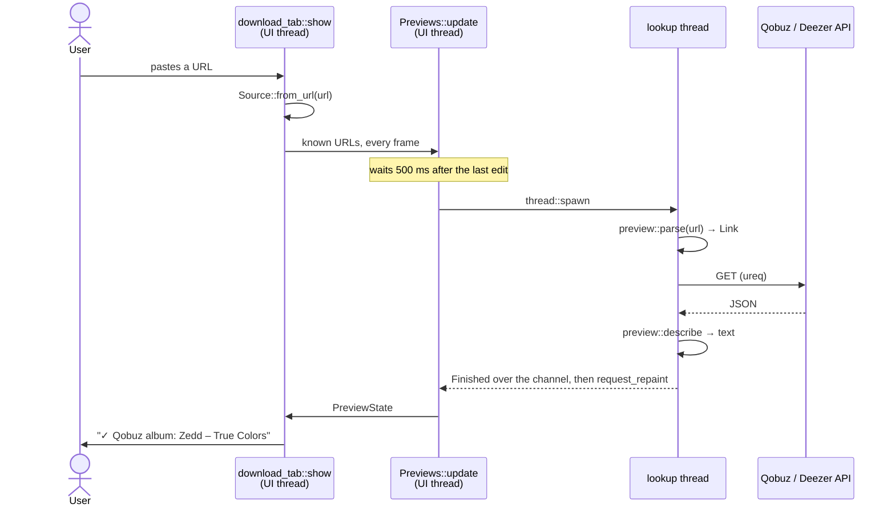

# URL recognition and Preview

When a URL is pasted into the Download tab, the app does two things with it.

First it **recognises** the URL. The host alone decides its Source. That
decision is what enables the Download button.

Then it looks up the URL's **Preview**: the kind, the artist and the title.
It asks the Source's public API, on a thread of its own. The Preview is only
information. It never blocks a Download. streamrip reads the URL again
itself when the Download runs.

Source, Preview and the other capitalised terms are defined in the
[glossary](../../../GLOSSARY.md).



## The examples

- **A**, a Qobuz album: `https://open.qobuz.com/album/0060254735180`. It goes
  through every step and ends as `✓ Qobuz album: Zedd – True Colors`.
- **B**, a Deezer share link: `https://deezer.page.link/urTH8Hw8bvwmJECH6`. It
  needs one extra request to find out where it leads.
- **C**, a Tidal URL: `https://tidal.com/browse/album/1`. It isn't recognised,
  so it stops at step 1.
- **D**, example A pasted before the first Qobuz Download. The lookup fails
  at step 5.

## Example A, step by step

### 1. Recognising the Source

The function is **`Source::from_url`**, in
`crates/ripandload-core/src/source.rs`. `download_tab::show`, in
`crates/ripandload/src/download_tab.rs`, calls it for every pasted URL. It
does so on every frame.

It takes the URL exactly as pasted, a string:
`"https://open.qobuz.com/album/0060254735180"`.

```rust
let (protocol, url) = url.split_once("://")?;
// …
let host_end = url.find(['/', '?', '#']).unwrap_or(url.len());
let (host, path) = url.split_at(host_end);
// …
let is_qobuz = host == "qobuz.com" || host.ends_with(".qobuz.com");
```

It gives back the Source the URL belongs to, or nothing if it belongs to
none. A `Source` is one of the two services the app downloads from, Qobuz or
Deezer. "Or nothing" is an `Option`. For A, the host is `open.qobuz.com`, so
the answer is `Some(Source::Qobuz)`.

> **Rust:** the `?` after `split_once` ends the whole function with `None`
> when the URL has no `://`. → [primer: `Option` and `?`](../rust-primer.md#option-and-the-question-mark)

Besides the host, it only checks that the scheme is `https` or `http` and
that there is a path. What the path says is read later, in step 4, on
another thread. So a Qobuz *label* URL still enables Download, because the
host is right. Whether streamrip can download it is streamrip's business. It just
never gets a Preview.

### 2. Waiting for the text box to settle

The function is **`Previews::update`**, in
`crates/ripandload/src/download_tab.rs`. `show` calls it on every frame. It
passes the URLs that have a Source, whether the text box changed this frame,
the Qobuz auth token from Settings, and the Streamrip config's path. The app
hands `show` that path from its `Places`.

For A, the URLs are `["https://open.qobuz.com/album/0060254735180"]`.

```rust
if let Some(edited_at) = self.edited_at {
    let settled_at = edited_at + SETTLE_TIME;
    let now = Instant::now();
    if now < settled_at {
        ctx.request_repaint_after(settled_at - now);
        return;
    }
    self.edited_at = None;
}
```

It gives nothing back. It changes `Previews` in place.

If the text box changed less than 500 ms ago, it stops here and comes back
later. Without the wait, typing a URL by hand would look up every prefix of
it.

The call to `request_repaint_after` is what makes it come back. egui only
draws a frame when something happens, such as a key press. If the user stops
typing, no frame would come, and `update` would never run again. So it asks
for a frame in 500 ms. → [architecture: the immediate-mode loop](../architecture.md#the-immediate-mode-gui-loop)

### 3. Starting a lookup thread

Still in **`Previews::update`**. Once the text box has settled, every URL
that hasn't been looked up yet gets a thread of its own.

```rust
self.by_url.insert(url.to_owned(), PreviewState::LookingUp);
let read_app_id = self.read_app_id;
let qobuz = self
    .qobuz_access
    .get_or_insert_with(|| QobuzAccess {
        app_id: streamrip_config.and_then(read_app_id).unwrap_or_default(),
        auth_token: qobuz_auth_token.to_owned(),
    })
    .clone();
// …
thread::spawn(move || {
    let result = preview::fetch(&url, &qobuz);
    // …
    let _ = sender.send(Finished { round, url, state });
    ctx.request_repaint();
});
```

First the URL is marked as being looked up. Its line now reads
`✓ Qobuz: https://open.qobuz.com/… · looking up…`.

Then the thread is handed a `QobuzAccess`. That is the two things Qobuz
wants on every request: an app ID and the user's auth token. The auth token
is one of the Credentials, from Settings. The app ID isn't. It belongs to
streamrip, which writes it into the Streamrip config on the first Qobuz
Download. `streamrip_config::qobuz_app_id` reads it from there. It is read
once per round, at the round's first lookup, here on the UI thread. Every
lookup of the round gets a copy.

`Previews` doesn't call `qobuz_app_id` by name. It keeps the function in its
`read_app_id` field, so its tests can put in one that counts the reads and
never touches the disk.

For A, after a first Qobuz Download, both fields are filled in:
`QobuzAccess { app_id: "…", auth_token: "…" }`.

> **Rust:** `move` gives the closure its own copies of `url`, `qobuz`,
> `sender` and `ctx`. That way the thread can keep running after this frame
> is over. → [primer: closures and `move`](../rust-primer.md#closures-and-move)

### 4. Reading the URL

The function is **`preview::parse`**, in
`crates/ripandload-core/src/preview.rs`. `preview::fetch` calls it, on the
lookup thread.

It takes the same URL string as step 1.

```rust
let (kind, id) = match source {
    Source::Qobuz => match segments[..] {
        [kind, id] => (kind, id),
        [_locale, kind, _slug, id] => (kind, id),
        _ => return None,
    },
    // …
};
```

It splits the path into parts and looks at how many there are. Qobuz URLs
have two shapes. The short one is `/album/<id>`. The long one is
`/<locale>/album/<slug>/<id>`.

It gives back a `Link`, or nothing. A `Link` is the URL taken apart into the
three things the API needs: the Source, the kind (album, track, playlist or
artist), and the Source's ID for it. For A:
`Some(Link { source: Qobuz, kind: Album, id: "0060254735180" })`.

> **Rust:** `match segments[..]` matches the *shape* of a list: exactly two
> parts, or exactly four. → [primer: slice patterns](../rust-primer.md#slice-patterns)

### 5. Asking the API

The function is **`preview::fetch`**, on the lookup thread. It takes the
`Link` from step 4 and the `QobuzAccess` from step 3.

```rust
Source::Qobuz => {
    if qobuz.app_id.is_empty() {
        return Err(PreviewError::NoQobuzAppId);
    }
    // …
    agent
        .get(format!("{QOBUZ_API}/{}/get", link.kind))
        .query(format!("{}_id", link.kind), &link.id)
        .header("X-App-Id", &qobuz.app_id)
        .header("X-User-Auth-Token", &qobuz.auth_token)
}
```

For A, it sends
`GET https://www.qobuz.com/api.json/0.2/album/get?album_id=0060254735180`,
with the app ID and the auth token in headers. Qobuz answers with JSON.

Every request gets a 10-second timeout (`TIMEOUT`).

Then it sends the request and reads the answer as text:

```rust
let body = request
    .call()
    .map_err(request_error)?
    .body_mut()
    .read_to_string()
    .map_err(request_error)?;
```

`fetch` gives back a `Result`: either a Preview or an error saying why there
is none. The error is a `PreviewError`, which lists every way a lookup can
fail. Step 6 makes the Preview.

> **Rust:** if the request fails, `map_err` turns ureq's error into a
> `PreviewError::Request`, using the `request_error` closure. The `?` after it then returns that error.
> → [primer: `Result`, `?` and error enums](../rust-primer.md#result-and-error-enums)

### 6. Naming it

The function is **`preview::describe`**, on the lookup thread. It takes the
Source, the kind, and the answer's text.

For A, the answer is long. The part that matters is
`{"title": "True Colors", "artist": {"name": "Zedd"}, …}`.

```rust
(Source::Qobuz, Kind::Album) => {
    Some(format!("{} – {}", text("/artist/name")?, title("/title")?))
}
```

It picks the names out of the JSON and joins them into one line. For A:
`Some("Zedd – True Colors")`.

`fetch` then wraps it into a `Preview`. A `Preview` is the kind plus that
line. For A: `Ok(Preview { kind: Album, text: "Zedd – True Colors" })`.

`describe` is its own function, apart from `fetch`, so that it can be tested
without the network. The tests give it JSON strings.

### 7. Back to the UI thread

The function is **`state_of`**, in `crates/ripandload/src/download_tab.rs`.
It still runs on the lookup thread. It turns the `Result` into what the URL's
line will show, a `PreviewState`. A `PreviewState` is one of three things:
still looking up, a Preview, or a short message saying why there is none.

For A: `PreviewState::Ready(Preview { kind: Album, text: "Zedd – True Colors" })`.

The thread sends it to the UI thread as a `Finished`, through a channel.
Then it asks for a repaint, so that a frame comes and picks it up.

On that frame, **`Previews::update`** takes it in:

```rust
for Finished { round, url, state } in self.receiver.try_iter() {
    if round == self.round {
        self.by_url.insert(url, state);
    }
}
```

The line now reads `✓ Qobuz album: Zedd – True Colors`.

> **Rust:** `try_iter` takes whatever is waiting on the channel, and doesn't
> wait if nothing is. This is how the UI thread hears from other threads
> without ever stopping a frame. → [primer: channels](../rust-primer.md#channels-and-try_recv)

The `round` check is explained in example D.

## Example B: a Deezer share link

Steps 1 to 3 go as for A. In step 1, `deezer.page.link` is one of Deezer's
hosts, so the Source is `Some(Source::Deezer)`. In step 3, the thread gets
the same `QobuzAccess`, but doesn't use it: Deezer's API needs no login.

In step 4 it differs. A share link says nothing about what it points to, so
`parse` gives back `None`. But `preview::is_share_link` recognises it, so
`fetch` follows it first:

```rust
None if is_share_link(url) => {
    let response = agent.get(url).call().map_err(/* … */)?;
    parse(&response.get_uri().to_string()).ok_or(PreviewError::UnreadableShareLink)?
}
```

It asks for the share link, and ureq follows the redirects. Say the request
ends up on `https://www.deezer.com/en/track/3135556?…`. `parse` reads that URL
instead: `Link { source: Deezer, kind: Track, id: "3135556" }`.

In step 5, it asks `GET https://api.deezer.com/track/3135556`. This is the
second request, so B can take up to 20 seconds in all.

Steps 6 and 7 go as for A. Deezer keeps the names in the same places as
Qobuz does for an album. The line ends up as
`✓ Deezer track: Daft Punk – Harder, Better, Faster, Stronger`.

## Example C: not a Qobuz or Deezer URL

In step 1, the host is `tidal.com`, so `Source::from_url` gives back `None`.

`show` draws the line as a warning,
`⚠ not a Qobuz or Deezer URL: https://tidal.com/browse/album/1`, and keeps
Download disabled. The URL is never passed to `Previews::update`, so nothing
is looked up.

## Example D: before the first Qobuz Download

Steps 1, 2 and 4 go as for A.

In step 3, the Streamrip config has no app ID yet, so the thread gets
`QobuzAccess { app_id: "", auth_token: "…" }`.

In step 5, `fetch` checks the app ID before sending anything. It is empty,
so `fetch` gives back `Err(PreviewError::NoQobuzAppId)`. No request is made,
and step 6 is skipped.

In step 7, `state_of` keeps this error's own message:

```rust
Err(err @ (PreviewError::NoQobuzAppId | PreviewError::NoQobuzToken)) => {
    PreviewState::Unavailable(err.to_string())
}
Err(_) => PreviewState::Unavailable("no preview".to_owned()),
```

A missing app ID or auth token says what to do about it. Any other failure
just says "no preview", and the full error goes to the Log file. So the line
reads `✓ Qobuz: https://… · no preview until the first Qobuz Download`.

The line still has a ✓. The Source is known, so Download stays enabled.

**After the Download.** That Download makes streamrip write the app ID. When
the Run hands over its `Outcome::Downloaded`, `RipAndLoadApp::run_finished`,
in `crates/ripandload/src/app.rs`, calls `DownloadForm::retry_previews`. That
calls `Previews::retry`:

```rust
fn retry(&mut self) {
    self.round += 1;
    self.qobuz_access = None;
    self.by_url
        .retain(|_, state| matches!(state, PreviewState::Ready(_)));
}
```

It adds one to `round`, drops the round's `QobuzAccess`, and forgets every
URL without a Preview. On the next frame, D is looked up again from step 3.
The new round reads the app ID again, finds it, and goes on as A.

`update` also calls `retry` when the Qobuz auth token in Settings changes, so
a URL that said "no preview without a Qobuz auth token in Settings" gets
another try.

That is what the `round` check in step 7 is for. A lookup from the old round
may still be running, holding the old empty app ID. When its answer arrives,
its `round` is out of date, so it is dropped.

## Where the threads are

- **The UI thread** runs steps 1, 2 and 3, and the end of step 7. It never
  waits on the network.
- **Each URL gets one lookup thread.** It runs steps 4 to 6 and the start of
  step 7. It is started with `thread::spawn` and never joined. It ends after
  sending its one `Finished`. If the app has closed by then, the send fails,
  and that is ignored.
- **There is one channel**, an `mpsc` channel owned by `Previews`. Each
  thread gets a copy of its `Sender`. The UI thread holds the `Receiver`.

The Download pipeline explains threads and channels in more depth. This is
the simplest case of the same pattern.
→ [Download: where the threads are](download.md#where-the-threads-are)

Tested by: `crates/ripandload-core/src/source.rs` (`qobuz_urls_are_qobuz`,
`deezer_urls_are_deezer`, `other_sources_are_none`,
`lookalike_hosts_are_none`), `crates/ripandload-core/src/preview.rs`
(`qobuz_urls_give_their_kind_and_id`, `other_urls_have_no_link`,
`only_deezer_share_links_are_share_links`,
`qobuz_responses_describe_what_was_pasted`,
`deezer_responses_describe_what_was_pasted`) and
`crates/ripandload/src/download_tab.rs` (`app_id_is_read_once_per_round`,
`retry_reads_the_app_id_again`, `missing_qobuz_access_says_what_to_do`,
`answers_from_the_old_round_are_dropped`). No test sends `fetch`'s requests.
